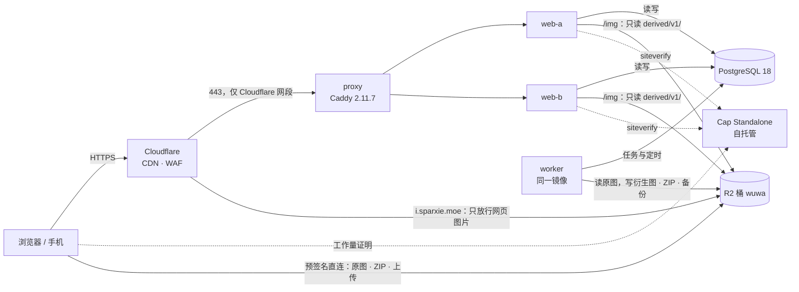
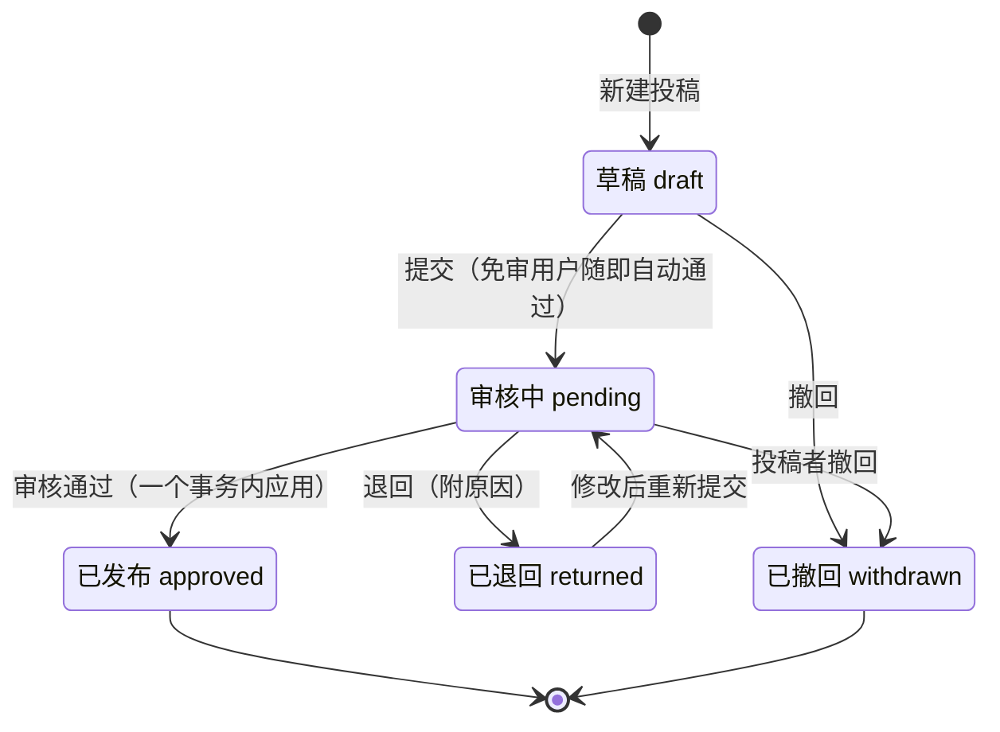

# 潮池 · 鸣潮表情包站架构

> 版本：v3，按实现编写（2026-10-20，以 `develop` 分支的代码为准，取代 v2 设计稿）
> 相关文档：`README.md`（本地开发与测试）、`deploy/README.md`（部署与运维）、`DEVELOPMENT.md`（R2 中的 v1 数据集）
> 本文不含密钥、服务器地址或账号标识。文中的「实测」都注明了日期和环境。

## 一页看懂

1. **应用**：一个 TanStack Start 应用（Bun 1.4.3，Nitro `bun` 预设）提供公开站、后台和 API。同一镜像以 `bun src/worker.ts` 运行图片衍生、ZIP 打包、备份和统计。PostgreSQL 18 是唯一的数据源。
2. **入口**：Cloudflare 代理 DNS → 源站 443（Cloudflare Origin CA 证书，SSL「完全（严格）」）→ 主机网络上的 Caddy 2.11.7 → 两个 web 副本。nftables 只允许 Cloudflare 网段连接 443，所有容器都不映射端口。不使用 Cloudflare Tunnel。
3. **构建与发布**：GitHub Actions 检查每次推送，通过后把镜像推送到公开的 GHCR 包；服务器不构建镜像。开发机执行 `deploy/release.sh`，服务器检出该提交，由 `deploy/rollout.sh` 先迁移、再逐个排空并替换两个副本。生产上经 Cloudflare 做健康探测的 11 次发布每次 19–52 秒，探测失败 0 次。
4. **存储**：所有文件放在 R2 桶 `wuwa`。海报、动图预览、立绘和头像在设置 `PUBLIC_IMG_BASE` 后由桶的自定义域（`i.sparxie.moe`）直接提供，未设置时走源站的 `/img`；弹窗大图 `full` 始终走 `/img`。这些图片都是一年期 immutable，由 Cloudflare 缓存。原图、ZIP 和上传用预签名链接直连 R2。下载链接 2 分钟有效；上传链接 15 分钟有效，并签入文件大小和类型。数据库备份用 AES-256-GCM 加密后才上传（第 12.5 节）。
5. **图片**：网页只显示 WebP（海报 `p240`、动图预览 `a160`、弹窗大图 `full`）。原图只在查看、保存和打包时下载，GIF 原样给出。表情在衍生图就绪之后才公开，包至少有一张公开表情才公开。
6. **公开页**：服务端渲染。瀑布流的位置是列宽的函数，由 CSS 定位，服务端 HTML、水合和图片加载都不移动布局。单张弹窗记在 `?e=`，地址栏显示为 `/e/<id>`。旧站地址 301 到新页面。白昼与夜潮两套配色。
7. **打包清单**：清单只存在浏览器里。`/batch` 在浏览器里用 client-zip 打包：每次签名 20 张，每 200 张一个 ZIP，附 `CREDITS.txt`；只提供预览的包不能加入。
8. **角色归属**：一张贴纸归哪个角色由一处规则决定：用贴纸自己的角色标签，整包复制的标签不算，单角色包归这个角色。张、包、合集包三种计数全站一致；角色可有官方立绘与按立绘取的主题色。
9. **权限**：站长、管理员、用户三种角色。每个服务端函数都必须声明权限中间件，单元测试检查遗漏；最后一位站长由数据库触发器保护；每次写操作都写审计日志。
10. **投稿**：所有注册用户都能投稿：草稿 → 审核中 → 已发布或已退回。待审核的图只经需要登录的 `/review-img` 预览，不进 CDN。用户投稿的图片只能经「投稿审核」上线，后台的「发布」不会绕过。
11. **下载与风控**：默认对所有人开放，不需要登录；社区包允许下载原图，官方包只提供预览。限额和速率在后台「下载与风控」里配置，留空即不限制；另有两个紧急开关。可疑来源可以封禁或观察，可疑请求要先通过人机验证。v1 来源地址不出现在公开页面和 `CREDITS.txt` 里。
12. **人机验证**：自托管的 Cap Standalone，在后台自动求解，不显示 Cap 组件，不需要点击；登录、注册、找回密码的提交按钮上方有一行状态文字。服务端在注册、登录、申请重置密码、游客评论和被挑战的下载上校验令牌；重发验证邮件不需要人机验证，按 IP 限每 10 分钟 3 次。不依赖 Cloudflare 的挑战服务。
13. **评论**：楼中楼、贴纸 `:s[r-…]`、回应、举报。markdown-it 关闭 HTML，链接只放行白名单协议；游客评论需要人机验证；站长和管理员的评论不进审核。
14. **不引入额外服务**：队列（pg-boss）、限流计数、会话和搜索（pg_trgm）都在 PostgreSQL 里，不用 Redis 和搜索引擎。
15. **仓库公开**：仓库里没有服务器地址和密钥。密钥只在服务器的环境文件和开发机的 `.env.local` 里；CI 用 gitleaks 扫描全部历史，GitHub secret scanning 与 push protection 已开启。

性能优化还在进行（第 8.5 节）。

---

## 1. 范围与约束

| 类别 | 现状 |
|---|---|
| 技术栈 | TanStack Start + Bun、PostgreSQL 18、Cloudflare（DNS、CDN、R2）、WebP |
| 已实现 | 公开浏览页（首页、目录、包详情、单张表情、角色、画师、画廊、探索、搜索、说明页）、打包清单与浏览器端打包、单张原图下载、整包 ZIP、评论与贴纸、注册登录、个人中心、投稿与审核、后台 16 个页面、白昼与夜潮两套配色 |
| 进行中 | 性能优化（第 8.5 节） |
| 部署 | 单机 Docker Compose，两个 web 副本滚动发布 |
| 存储 | 只用 R2 桶 `wuwa`，按对象种类分前缀 |

硬约束：

- 不使用 Cloudflare Workers 运行应用，不执行 wrangler。Cloudflare 只承担 DNS、CDN、WAF 和 R2。
- 桶内的 v1 布局（`meta/v1/`、`assets/v1/packs/`、`sync/v1/`）与 15,272 张原图不改键、不搬动。
- 密钥只通过服务器上的环境文件注入，不进仓库、镜像、文档和数据库。
- 开发和测试环境不能连到生产桶：`src/server/env.ts` 的 `assertSafeStorage` 在非生产环境拒绝 R2 上的桶 `wuwa`（除非显式设置 `ALLOW_PROD_BUCKET`），测试拒绝使用 `wuwa`。
- 内容授权是项目级风险，优先级高于工程决策（第 6.4 节）。

数据规模：

| 项 | 数值 | 来源 |
|---|---|---|
| 表情包 | 310 个：已发布 309、草稿 1、官方 40 | 生产导入 `import-v1`，2026-10-20 |
| 表情 | 15,272 张 | 生产导入 `import-v1`，2026-10-20 |
| 角色 / 画师 / 标签 | 71 / 31 / 6；41 个哈希 slug 已替换为可读 slug | 生产导入，2026-10-20 |
| 旧链接重定向 | 首次导入 690 条、导入警告 0 条；加入 v1 标签页后 `redirects` 共 779 条 | 生产导入，2026-10-20 |
| 原图尺寸 | `backfill-dims` 更新 15,272 张、失败 0 张 | 生产，2026-10-20 |
| 衍生图回填 | `backfill-derived` 完成 15,272 / 15,272 张 | 生产，2026-10-20 |
| 原图体积 | 15,028,946,607 字节（约 14.0 GiB） | `DEVELOPMENT.md` 第 3 节，R2 上传统计，2026-10-20 |

格式分布、尺寸分布和源站下载量沿用 v2 文档的统计，本版没有重新测量，见附录 C。

---

## 2. 请求路径



- 页面、API 和未命中缓存的 `/img` 经 Cloudflare 到达 Caddy，Caddy 轮询分给 web-a 和 web-b。`/img` 命中 Cloudflare 缓存时不回源。
- 设置 `PUBLIC_IMG_BASE` 后，海报、动图预览、立绘和头像从桶的自定义域加载：Cloudflare 未命中时直接读 R2，不经过源站（第 2.3 节）。
- 原图、ZIP 和上传不经过应用：应用只签发链接，浏览器直连 R2 的 S3 端点。
- 源站不监听 80 端口。`http://` 由 Cloudflare「始终使用 HTTPS」在边缘重定向。
- Caddy 只服务 `CHAOCHI_DOMAIN`，`www.` 子域 301 到主域；其他 Host 直接断开连接，未知 SNI 和直接用 IP 访问因为没有匹配的证书而握手失败（`deploy/caddy/Caddyfile`）。
- 请求体最大 8 MB（Caddy `request_body`），超出返回 413。表情上传用预签名链接直传 R2，应用只收到 JSON 和头像裁切图（不超过 2 MB）。TanStack Start 在服务端函数的校验运行之前就读完整个请求体，所以上限放在代理层。
- 客户端 IP 只取 `CF-Connecting-IP`，不读 `X-Forwarded-For`。这个头可信的前提是：nftables 只允许 Cloudflare 网段连接 443，Caddy 只信任来自这些网段的该头并原样转发，应用容器不映射任何端口。

### 2.1 路由与缓存

缓存是否可共享由应用决定（`src/server/http/security.ts`，在 `src/start.ts` 的请求中间件里对所有响应生效）。Cloudflare 不认 `Vary: Cookie`，所以 HTML 的规则是：请求带会话 Cookie（`__Secure-better-auth.session_token` 或 `better-auth.session_token`）时一律 `private, no-store`；不带 Cookie 时，由目录数据渲染的页面（`/`、`/packs`、表情包页、`/characters`、`/about` 等，loader 声明可边缘缓存）返回 `public, s-maxage=30, stale-while-revalidate=300`，其余 2xx、404、410 HTML（如 `/login`、404 页）返回 `public, s-maxage=60, stale-while-revalidate=600`；匿名 HTML 里不出现与身份相关的内容。

| 路由 | 用途 | 缓存 |
|---|---|---|
| `/`、`/packs`、`/packs/:slug`、`/e/:emojiId`、`/characters`、`/characters/:slug`、`/artists`、`/artists/:slug`、`/gallery`、`/explore`、`/search`、`/batch`、`/about`、`/links`、`/legal`、`/legal/:doc` | 公开页，服务端渲染（第 8.3 节） | 按上面的 Cookie 规则 |
| `/login`、`/register`、`/forgot-password`、`/reset-password`、`/verify-email` | 账号页面 | 按上面的 Cookie 规则 |
| `/submit`、`/me/*`、`/admin/*` | 投稿、个人中心、后台，需要登录 | 一律 `private, no-store`（路径前缀不区分大小写） |
| `/archives/*`、`/tags/*` | 旧站地址（第 8.3 节） | 查到时重定向，`public, max-age=86400`（带会话 Cookie 时 `private, no-store`）；查不到时渲染 404 页 |
| 其他未匹配的地址 | 站点外壳里的 404 页，状态码 404 | 按上面的 Cookie 规则 |
| `/img/v1/:variant/:packKey/:file`、`/img/v1/portrait/:file` | 已发布表情的 WebP 衍生图、角色立绘 | `public, max-age=31536000, immutable`，不看 Cookie（第 2.2 节） |
| `/review-img/v1/:variant/:packKey/:file` | 待审核表情的预览图，只对审核人、包的所有者和上传者开放 | `private, no-store`；拒绝时一律 404 |
| `/dl/e/:emojiId?mode=view\|save` | 查看或保存原图 | 检查后 302 到预签名链接（`Accept: application/json` 时返回 JSON）；`private, no-store` |
| `/dl/p/:slug.zip` | 整包 ZIP | 同上；ZIP 未生成或已过期时排队并返回 202，`?poll=1` 只查询状态 |
| `POST /api/batch/sign` | 打包清单分批签名 | `private, no-store` |
| `/api/health` | 健康检查：`select 1`，2 秒超时 | `no-store` |
| `/api/auth/*` | Better Auth | 没有显式缓存头时 `no-store` |
| 服务端函数 | 页面数据与写操作 | 公开目录数据（`src/server/catalog/fns.ts`，不含随机结果）的匿名 GET 成功时为 `public, s-maxage=30, stale-while-revalidate=300`（`src/server/http/edge-cache.ts`）；请求带会话 Cookie 时一律 `private, no-store`；其余没有显式缓存头时 `no-store` |
| `/kit` | 组件样张 | 只在开发环境存在，生产返回 404 |

另外两条规则：任何带 `Set-Cookie` 的响应都改为 `private, no-store`；5xx 页面和重定向没有显式缓存头时为 `no-store`。

**登录提示 Cookie。** Cloudflare 的缓存键不含 Cookie：匿名请求把公开页放进边缘缓存后，带会话 Cookie 的请求也会命中这份匿名 HTML（`cf-cache-status: HIT`），源站的 `private, no-store` 根本没有机会生效。根路由下发的 viewer 于是为空，页头显示「登录」，没有模拟登录条，而且根配置不随页面切换刷新（`staleTime: Infinity`）。补救靠一个只表示「这个浏览器有会话」的 Cookie `tp_signed_in=1`（`src/shared/signed-in-hint.ts`）：

- 不含身份信息，不是 HttpOnly（页面要读它），`Path=/`、`SameSite=Lax`，生产环境带 `Secure`，有效期与会话 Cookie 相同。
- 服务端由 Better Auth 的 after 钩子维护（`src/server/auth/signed-in-hint.ts`），对 `/api/auth/*` 与服务端函数里的 `auth().api.*` 都生效：响应设置会话 Cookie 时设置它（登录、注册后直接登录、验证邮件自动登录、模拟登录与结束模拟、每日刷新会话），响应让会话 Cookie 过期时清除它（退出、会话已失效）；会话有效但请求里没有提示的 `get-session` 会补上它（上线前已登录的会话）。所以它的 `Set-Cookie` 只会和会话 Cookie 自己的 `Set-Cookie` 一起出现，或者出现在带有效会话 Cookie 的请求的响应上，这两种响应本来就不共享缓存。
- 缓存规则不看它：只带提示的请求仍按匿名处理，匿名 HTML 照常共享。所以服务端从不在匿名响应上清除一个过期的提示，由浏览器自己删。
- 浏览器端：`<head>` 里的启动脚本看到提示就给 `<html>` 加 `data-viewer-pending`，页头先隐藏「登录」但保留位置，3 秒后无论如何恢复。水合后如果根路由的 viewer 为空而提示还在，调用一次 `getPublicConfig()`（从不共享缓存）：拿到 viewer 就重新加载根路由，页头、模拟登录条和其他读根配置的组件随之更新；拿不到就删掉提示（`src/ui/shell/viewer-refresh.ts`）。没有提示的匿名访客不多发请求。重新加载根路由时，已超过 `staleTime` 的页面数据也会随之重新请求一次。评论区的身份来自评论服务端函数，每个访客各自请求，不受这个问题影响。
- 可选的额外保险，目前没有配置：站长可以在 Cloudflare 加一条 Cache Rule，请求 Cookie 含 `better-auth.session_token`（也匹配 `__Secure-` 前缀的名字）时绕过缓存，只作用于页面，排除 `/img/`、`/assets/`、`/fonts/` 与 `/_serverFn/`。有了它，登录用户的页面请求直接回源；提示机制照样保留，规则缺失或失效时仍然有效。

### 2.2 `/img` 规则

`/img` 是源站上的网页图片出口，只读 `derived/v1/` 下已发布表情的对象、`characters/v1/portraits/` 下的角色立绘和 `avatars/v1/` 下的用户头像（`src/server/media/img.ts`、`src/routes/img/$.ts`）。设置 `PUBLIC_IMG_BASE` 后页面不再用它加载海报、预览、立绘和头像（第 2.3 节），但它仍然提供所有档位：旧链接、缓存里的旧 HTML、浏览器端读图片字节的脚本和开发环境都用它。

| 项 | 规则 |
|---|---|
| 路径 | `/img/v1/<variant>/<packKey>/<emojiId>.r<rev>.webp`，版本号必带 |
| 校验 | `variant` ∈ `p240`、`a160`、`full`；`packKey` 匹配 `^[a-z0-9](?:[a-z0-9-]{0,98}[a-z0-9])?$`；`emojiId` 匹配 `^r-[0-9a-f]{20}$`；`rev` 为不以 0 开头、最多 9 位的整数。现有 309 个包键与 15,272 个表情 ID 全部符合；新包的包键由服务端生成，同样满足该正则 |
| 映射 | 只拼成 `derived/v1/<variant>/<packKey>/<emojiId>.r<rev>.webp`，不接受其他前缀 |
| 命中 | 流式转发 R2 对象，`Cache-Control: public, max-age=31536000, immutable`，带 `ETag` 与 `X-Content-Type-Options: nosniff`；`If-None-Match` 命中时返回 304；支持 HEAD，其他方法返回 405 |
| `full` 未生成 | 只有这一步查库：表情和包都已发布、URL 的 `packKey` 等于 `storage_pack_key`、`rev` 等于 `variant_rev`，否则 404。条件满足才入队 `media.full`（单例键为表情 ID，重复请求只排一次），并 302 到同一张图的 `a160`（动图）或 `p240`（静态图），`Cache-Control: no-store`。worker 只按库里的字段拼对象键，拒绝处理未发布的表情，所以待审核的图不会被人按 ID 请求进 `derived/` |
| 角色立绘 | `/img/v1/portrait/<name>.<hash8>-<w>.webp`，`<name>` 是导入时的角色 slug，`<w>` 为 240 或 480。严格匹配后直接读 `characters/v1/portraits/` 下的同名对象，立绘本身公开，不查库；命中时同样是一年期 immutable |
| 用户头像 | `/img/v1/avatar/<userId>/<hash>-<256\|64>.webp`，`<hash>` 为 16 位十六进制。严格匹配后直接读 `avatars/v1/` 下的同名对象，不查库；命中时一年期 immutable（第 7.3 节） |
| 其他缺失 | 404，`Cache-Control: public, max-age=60`，避免长期缓存 404 |
| Cookie | 注册为独立的服务端路由，不调用会话接口，响应不带 `Set-Cookie`。Cloudflare 不缓存带 `Set-Cookie` 的响应 |

版本号必带，是因为「重新生成衍生图」会递增 `variant_rev`：页面总是输出新地址，旧地址留在缓存里也不会再被引用。

Cloudflare 侧：Cache Rule 对 `/img/*` 设为「如果存在 Cache-Control 标头则使用，否则绕过缓存」，这样 302 不会被缓存、404 只缓存 60 秒；开启 Smart Tiered Cache，冷图回源集中到上层机房（第 12.4 节）。

### 2.3 桶的公开域名（`PUBLIC_IMG_BASE`）

冷图经 `/img` 时一次约 840 ms（2026-10-21 实测：Cloudflare 到源站约 200 ms，源站读 R2 约 285 ms，源站没有缓存）。所以桶 `wuwa` 绑定了自定义域 `i.sparxie.moe`，网页图片由它直接提供，对象键不变：

| 项 | 规则 |
|---|---|
| 地址 | `${PUBLIC_IMG_BASE}/<对象键>`，例如 `…/derived/v1/p240/<packKey>/<emojiId>.r<rev>.webp`、`…/characters/v1/portraits/<文件>`、`…/avatars/…`。只有 `src/server/media/keys.ts` 的 `webImageUrl` 决定用哪种地址，所有调用方都经过它 |
| 档位 | `p240`、`a160`、立绘、头像走公开域名；`full` 仍走 `/img`（首次打开时才生成，之前 302 到海报或预览）；待审核预览图仍走 `/review-img` |
| 未设置 | 所有地址与以前完全相同（`/img/…`） |
| 读字节的脚本 | 复制图片要把图画到 canvas 上，跨域图片会污染 canvas。所以脚本总是按对象键换回同源的 `/img` 路径（`src/shared/web-image.ts`），`/img` 的 302 也留在源站，不依赖桶的 CORS |
| 缓存头 | worker 写 `derived/`、`characters/v1/portraits/`、`avatars/` 时默认带 `Cache-Control: public, max-age=31536000, immutable` 和 `image/webp`，公开域名原样返回，不需要控制台规则。旧对象可用 `bun src/cli.ts media set-cache-control --prefix derived/v1/` 补齐（已正确的对象跳过） |
| 只放行图片 | 桶里还有备份、原图、待审核预览图、ZIP、上传暂存和 v1 快照。公开域名必须只放行 `derived/v1/*`、`characters/v1/portraits/*`、`avatars/*`，其余一律拒绝（Cloudflare WAF 规则，第 12.4 节）。`bun src/cli.ts media check-public --base <域名>` 用桶里真实存在的键逐个前缀检查，只打印前缀和状态码 |
| 安全头 | CSP 的 `img-src` 加入该域名的源（`connect-src` 不加，脚本不从它取字节）；页面 `<head>` 对它 `preconnect` |
| 下架 | 仍然是删除 R2 对象；缓存清除同时清 `/img` 地址和公开域名地址（第 6.3 节） |

公开域名的 GET 由 Cloudflare 缓存（2026-10-21 实测 `cf-cache-status: HIT`；HEAD 请求显示 `DYNAMIC`，不影响）。

---

## 3. 存储：R2 桶 `wuwa`

对象键由 `src/server/media/keys.ts` 统一生成：

```text
wuwa/
├── meta/v1/ …  sync/v1/state.json                     # v1 快照：只读，仅作导入来源
├── assets/v1/packs/<packKey>/
│   ├── pack.json                                      # v1 快照文件，只读
│   └── emojis/<emojiId>.<gif|png|webp|jpg>            # 原图：v1 的 15,272 张 + 新上传
├── derived/v1/<p240|a160|full>/<packKey>/<emojiId>.r<rev>.webp  # 已发布表情的 WebP，经 /img 提供
├── review/v1/<p240|a160>/<packKey>/<emojiId>.webp     # 待审核表情的预览图，通过后复制到 derived/v1/
├── zips/v1/packs/<packKey>/<packKey>.<hash8>.zip      # 整包 ZIP，按内容哈希命名
├── uploads/tmp/<yyyy>/<mm>/<dd>/<uploadId>/<文件名>    # 直传暂存（UTC 日期）· 生命周期 7 天
├── backups/postgres/<yyyy>/<mm>/<dd>/<时间戳>.dump.enc # 加密的数据库备份（UTC 日期）· 生命周期 30 天
├── characters/v1/portraits/<slug>.<hash8>-<240|480>.webp  # 角色立绘（第 7.2 节），经 /img/v1/portrait/ 提供
├── avatars/v1/<userId>/<hash>-<256|64>.webp          # 用户头像（第 7.3 节），按内容寻址
└── design/v1/                                         # 设计稿归档（design/prototype/README.md）
```

规则：

1. **分类由数据库负责**。角色、画师、标签与表情是多对多，无法用单一目录表达；目录按「对象种类 → 规格版本 → 所属包」分层，同一层不会堆上万个对象。
2. **对象写入后不搬动**。原图键记在 `emojis.original_key`；`storage_pack_key` 是入库时所属的包，之后表情移到别的包也不移动文件。
3. **每张表情独占自己的对象，不共用**。SHA-256 只用来发现重复：同一包内的重复文件直接跳过（上传记录为 `duplicate`）；与其他包重复时，在审核卡片和表情库详情里提示。v1 导入的表情在首次生成衍生图时补算 SHA-256。下架一张表情时可以直接删除它的文件，不需要引用计数。
4. **衍生图键可直接算出**：`derived/v1/<variant>/<storagePackKey>/<emojiId>.r<variant_rev>.webp`，生成 URL 不查额外的表。`variant_rev` 从 1 开始，重新生成时递增。
5. **待审核的图不进 `derived/`**。worker 把待审核表情的预览图写到 `review/v1/`（对象缓存头为 `private, no-store`），只经需要登录的 `/review-img` 提供。审核通过时复制到 `derived/v1/` 并删除预览图；预览图缺失时改为排队重新生成到 `derived/`。退回的图片从未进入 CDN，删除时也无需清除缓存。
6. **规格升级**时生成 `derived/v2/…` 并回填，切换后整体删除 v1。
7. **会过期的对象**放在独立前缀：`uploads/tmp/` 与 `backups/` 由 R2 生命周期规则清理（第 12.4 节）；被清理的投稿由每天的定时任务删除其原图、预览图和暂存文件（第 5.2 节）。
8. **访问方式**：已发布的衍生图和立绘经 `/img`，或设置 `PUBLIC_IMG_BASE` 后经桶的自定义域（第 2.3 节）；其他前缀不能经公开域名访问。原图与 ZIP 用预签名 GET，有效 120 秒，「保存」带 `attachment` 和文件名，「查看」为 `inline`。上传用预签名 PUT，有效 900 秒，只能写 `uploads/tmp/`，`Content-Length` 与 `Content-Type` 都是签名头（`X-Amz-SignedHeaders=content-length;content-type;host`），存储拒绝大小或类型不同的请求体。2026-10-20 在 R2 上用 `bun src/cli.ts presign-selftest` 实测：大小相同的 PUT 返回 200，多 1 字节的 PUT 返回 403。

---

## 4. 图片策略

网页上只出现 WebP；原图只在用户明确要求时加载。衍生图由 worker 生成（`src/server/media/derive.ts`、`src/server/jobs/handlers/media.ts`）。

| 档位 | 规格 | 用在哪里 |
|---|---|---|
| 原图 | GIF / PNG / WebP / JPEG，原样 | 「查看原图」「保存原图」、ZIP |
| `p240` 海报 | 静态 WebP q72，最长边 240，不放大 | 所有网格、卡片、评论贴纸的默认显示 |
| `a160` 预览 | 动画 WebP q40，最长边 160，抽帧到 ≤ 24 帧（被跳过的帧时长并入保留帧）；只为动图生成 | 悬停或进入可视区时播放 |
| `full` | 原尺寸；动图为全帧动画 WebP q60，静态图为 WebP q80 | 单张弹窗；首次请求时生成，生成前 302 到 `a160` 或 `p240` |

各档位的体积本版没有在生产数据上重新测量；设计阶段对样本的测量见附录 C。

- **海报帧**：取第 0、¼、½、¾ 帧中图像熵最高的一帧，写入 `emojis.poster_frame`，表情库详情里显示。每次重新生成都重新计算。
- **抽帧实现**：先把动图解码为 RGBA 长条，抽出保留的帧并缩放，再用 sharp 的 `raw: { width, height, channels, pageHeight }` 重新包装后编码。`webp()` 没有 `pageHeight` 参数，传了会被忽略，输出变成一张竖长的静态图。
- **每帧都相同的动图按静态图保存**：WebP 编码器会合并相邻的相同帧。`a160` 编码后不足 2 帧，说明原图每一帧都一样，这时不保存 `a160`，`frames` 记为 1，只有 `p240`。
- **上传限制**：单个文件 ≤ 20 MB，边长 ≤ 2048，帧数 ≤ 400，帧数 × 宽 × 高 ≤ 1.2 亿像素。超出时 ingest 失败并在上传列表里显示原因。
- **并发与内存**：表情图片的 sharp 工作只在 worker 进程和一次性的命令行容器里运行（web 进程只处理头像上传，第 7.3 节），`sharp.cache(false)`、`sharp.concurrency(1)`，`limitInputPixels` 为 1.2 亿。`media.derive` 队列每个 worker 同时跑 6 个任务，但 `oneImageAtATime` 让同一进程里的 sharp 工作一次只做一个，内存里最多有一张解码后的动图；任务之间重叠的是 R2 读写。等待中的工作 `media.derive`（审核预览与公开衍生图）先于 `media.full`（单张弹窗的原尺寸图），正在做的不打断，一批原尺寸图不会拖慢审核预览；`media.ingest` 只读元数据，不占这个名额。任务超时由 pg-boss 的 `expireInSeconds` 控制（第 12.5 节）。
- **实测（生产，2026-10-20，v1 回填）**：并发 1 时每个任务 2.3 秒，worker 只用到单核的 8%；改为 6 个并发后每分钟 112 个任务，worker CPU 48%、内存 258 MB。

---

## 5. 角色与投稿

### 5.1 三种角色

| 能做什么 | 站长 | 管理员 | 用户 |
|---|:-:|:-:|:-:|
| 浏览、下载、收藏、评论 | ✓ | ✓ | ✓ |
| 投稿表情包（需审核，可设免审） | ✓ | ✓ | ✓ |
| 审核投稿，发布与下架表情包 | ✓ | ✓ | — |
| 表情包与表情增删改查、上传中心 | ✓ | ✓ | — |
| 角色、画师、标签整理与合并 | ✓ | ✓ | — |
| 评论审核、屏蔽词、禁止评论 | ✓ | ✓ | — |
| 用户与权限、模拟登录、下载与风控 | ✓ | — | — |
| 存储、任务队列、审计日志、系统设置、彻底删除表情包 | ✓ | — | — |

权限表在 `src/shared/roles.ts`：站长持有全部权限；管理员持有 `dash`、`packs`、`review`、`upload`、`taxonomy`、`comments`、`submit`；用户只有 `submit`。

- 只有站长能任命或撤销管理员。最后一位未被封禁的站长不能被降级、封禁或删除。第一位站长用命令行设置：`bun src/cli.ts promote-admin <邮箱>`。
- 每个用户有投稿模式：`review`（默认，需审核）、`trusted`（免审，提交后自动通过）、`blocked`（禁止投稿）。投稿模式只有站长能改；被封禁的账号按 `blocked` 处理。投稿模式每次从 `users` 表读取，不信任会话缓存。
- 用户只能修改自己的投稿。审核人能查看所有投稿，但不能代为修改；其他人访问时得到与「不存在」相同的 404。对象键由服务端生成。
- 每次写操作写入 `audit_logs`：操作人、当时的角色、动作、对象和变更内容；站长模拟登录期间的写操作另记 `impersonated_by`。命令行改角色、举报自动隐藏评论这类没有操作人的写操作，`actor_id` 为空。

实现：

- Better Auth `admin()` 插件配合自定义访问控制（`src/server/auth/access.ts`），角色为 `admin`（站长）、`manager`（管理员）、`user`。`admin` 角色显式包含插件自带的 `adminAc.statements`，否则站长自己调用设置角色等接口也会被拒绝。`adminRoles` 只有 `admin`，管理员和用户拿不到列出用户、设置角色、封禁、模拟登录等接口。
- 「至少一位站长」由 `users` 表上的触发器 `users_keep_last_admin` 保证（`BEFORE UPDATE OF role, banned OR DELETE`），因为插件的设置角色、封禁、删除接口不经过业务代码。触发器先锁定全部站长行（`FOR UPDATE`）再计数，两个并发操作不会同时成功。
- 业务权限是共用的服务端函数中间件：`publicFn`（公开）、`requireUser`（需要登录）、`requirePerm(perm)`（需要权限）。`tests/unit/server-fn-guard.test.ts` 用 TypeScript 编译器解析 `src/` 下所有 `.ts`、`.tsx` 文件，任何一条 `createServerFn()` 链没有声明其中之一就失败。服务端路由（`/dl`、`/img`、`/review-img`、`/api/batch/sign`）在处理函数里自己检查。
- 后台每个页面对应一个权限（`src/ui/admin/nav.ts`），菜单只是镜像。`tests/admin/matrix.test.ts` 对后台与「下载与风控」的每个服务端函数断言：未登录 401，用户 403，管理员只在其权限内放行，站长全部放行。
- 模拟登录：站长在「用户与权限」里以某个用户的身份浏览，不能模拟自己。Better Auth 把会话换成目标用户的会话，有效 30 分钟。期间每个页面（公开站和后台）顶部显示「正在以 … 的身份浏览」和「结束模拟」按钮；结束后恢复站长自己的会话，回到「用户与权限」。开始和结束都写审计日志。
- 验收测试：管理员和用户调用设置角色接口返回 403，未登录返回 401（`tests/integration/auth.test.ts`）；最后一位站长不能被降级、封禁或删除（`tests/integration/last-admin.test.ts`）。

### 5.2 投稿状态



状态表是 `src/server/submissions/rules.ts` 的 `TRANSITIONS`，每次转换在 SQL 里再按允许的来源状态检查一次（`UPDATE … WHERE status IN …`），两个并发操作不会同时成功。已退回的投稿不能撤回，只能修改后重新提交。

- **三类投稿**：新包（`new_pack`）、补充表情（`add_emojis`）、修改已发布的包（`edit_pack`），都存在 `submissions` 表。`payload` 保存提议的内容：标题、简介、说明、角色、画师（`artistIds`，以及目录里还没有的画师名 `artistNames`）、约稿人、新增和移除的表情、封面、类型，新包还有「官方表情」标记 `official`。`declaration` 保存授权声明：身份（画师本人、约稿人、已获授权、整理搬运）、许可、凭证链接、说明，以及投稿者希望的「允许下载」。
- **新包**：先建一个 `status = draft` 的包，属于投稿者，前台不可见；包键由标题拼音加随机后缀生成。修改已发布的包只限包的所有者或有 `packs` 权限的人；补充表情对任何已发布的包开放。每人最多 30 个草稿。
- **上传**：浏览器为每个文件申请预签名 PUT（每次最多 50 个，每个投稿最多 200 张，单个 ≤ 20 MB，GIF、PNG、WebP、JPEG），直传 `uploads/tmp/…`，完成后通知服务端排队 `media.ingest`。ingest 校验格式、尺寸与帧数（第 4 节），计算 SHA-256（同一包内重复直接跳过），把原图复制到 `assets/v1/packs/<packKey>/emojis/`，建一张 `pending` 状态的表情，再排队生成 `p240` 与 `a160` 预览图到 `review/v1/`。投稿者和审核人经 `/review-img` 预览。
- **顺序**：上传列表保持选择文件时的顺序；投稿者可以拖动排序，顺序存在 `payload.addEmojiIds`。
- **提交**：缺少标题、表情、画师（新包）、授权说明，或者还有图片在上传或处理中时，不能提交。
- **审核通过**：在一个事务里应用 `payload`：投稿自己的表情转为 `published` 并排在已有表情之后；修改投稿移除的表情转为 `hidden`；更新包信息、角色与画师（按名称或别名匹配已有画师，没有则新建）、计数、类型和封面；新包同时生成 slug 并发布。「允许下载」由审核人确认，官方表情固定关闭。随后发送通知、写审计日志。事务提交后再把预览图复制到 `derived/v1/`（最多 6 个并行），包允许下载时排队重建 ZIP。衍生图就绪（`derived_ready`）之后，表情和包才在公开页出现（第 8.3 节）。
- **修改已发布的包**：`submissions.base_updated_at` 记录创建时包的 `updated_at`。审核通过前线上一直显示旧版本；如果期间包已被别人改过，审核通过失败，需要退回重新提交（重新提交时以包的当前版本为基准）。下载计数等不改变包内容的更新不会移动 `updated_at`。
- **免审用户**：提交后立即以投稿者本人身份执行「审核通过」，「允许下载」取投稿者的声明；审计日志记为 `auto`。自动通过失败（例如包已被改过）时投稿留在审核中，等待审核人处理。
- **后台「发布」不绕过审核**：「上传中心」里由站长或管理员直接传进已有包的图片，生成预览图后直接发布。属于用户投稿的待审核表情（上传记录指向投稿，或仍在某个未结束投稿的 `addEmojiIds` 里）在表情库和包编辑页上不能「发布」，只能经「投稿审核」上线，因为只有审核会应用授权声明和「允许下载」。
- **审核页**：每条投稿列出自动检查：本包内重复、与其他包重复、画师与授权是否填写、是否附凭证、许可；修改投稿另列字段差异与冲突状态。退回原因有模板。
- **定时清理**（每天 04:30，`src/server/submissions/cleanup.ts`）：退回或撤回超过 30 天的投稿、90 天未修改的草稿，删除其待审核表情的原图与预览图、残留的暂存文件和投稿记录；新包投稿的草稿包在没有其他引用时一并删除。已发布的表情从不在这里删除。

---

## 6. 下载、打包与风控

### 6.1 下载方式

| 场景 | 流程 |
|---|---|
| 查看原图 | `/dl/e/:id?mode=view` → 检查 → 302 到 `inline` 预签名链接 |
| 保存原图 | `/dl/e/:id?mode=save` → 检查 → 302 到 `attachment` 预签名链接，文件名与 ZIP 内一致：`<slug>-<序号>.<扩展名>` |
| 整包 ZIP | `/dl/p/:slug.zip` → 检查 → `zip_artifacts` 中有当前内容哈希的 ZIP 则计数并 302；否则排队生成，返回 202（`Retry-After: 5`），前端用 `?poll=1` 轮询，轮询不计数 |
| 打包清单 | `POST /api/batch/sign` 分批签名，每批 1–20 张；浏览器端打包界面见第 8.3 节 |

`/dl/e` 与 `/dl/p` 在请求带 `Accept: application/json` 时返回链接、文件名和有效期，不做 302；打包签名只返回 JSON。所有响应都是 `private, no-store`。

检查顺序（`src/server/downloads/policy.ts`，纯函数，用内存假数据做单元测试）：

1. **可下载**：表情和包都已发布，且包的「允许下载」开启。待审核表情的原图只对包的所有者和审核人签发，且不要求「允许下载」（新包在审核前一直是关闭的）。隐藏的表情和包对所有人返回 404。
2. **紧急开关**：「原图仅限登录用户」「暂停整包与打包」。
3. **来源与可疑请求**：命中封禁的来源返回 403；命中观察名单或判定为可疑时要求人机验证（第 6.2 节）。
4. **速率**：按 IP 每分钟计数，单张与打包分开。
5. **每日限额**：按 Asia/Shanghai 的自然日计数。
6. **签发时计数**：预签名链接被浏览器直接使用、不经过应用，所以计数只能在签发时完成；只有放行的签发才计数，被拒绝的请求不计。

打包清单接口（`src/server/downloads/handlers.ts`）：

- 请求体 `{ volume, first, ids }`：`volume` 是一个 UUID，代表浏览器生成的一个压缩包；`ids` 为 1–20 个表情 ID。路由自己检查 `Origin`（没有时检查 `Referer`）必须是本站，因为 Start 的 CSRF 中间件只保护服务端函数。
- 响应列出放行的表情（预签名链接与文件名）、被拒绝的表情和原因、这些表情所属包的 `CREDITS.txt` 内容，以及因分钟速率被暂缓时的 `retryAfter`。
- 服务端第一次为某个 IP 的某个 `volume` 放行表情时，把它记为一次整包下载。是否计数与客户端的 `first` 标记无关：客户端不能靠不发 `first` 跳过计数，重试第一批也不会重复计数。
- 链接有效 2 分钟，浏览器边打包边签下一批，慢网速下也不会中途过期；放弃的打包只计已签发的批次。

整包 ZIP（`src/server/media/zip.ts`）：

- 每个已发布且允许下载的包一个 ZIP，存储模式（GIF、PNG 不再压缩），原图一张一张流式写入并分片上传，内存只占几个分片，与包的大小无关。压缩包里附 `CREDITS.txt`：站点名与地址、包名、本站页面地址、画师、约稿人、许可与说明。v1 的来源地址（`packs.source_url`）只留在数据库和后台编辑器里，不出现在公开页面、页面数据、整包 ZIP 和打包清单的 `CREDITS.txt` 里。
- 内容哈希（`chaochi-zip-v2`）覆盖压缩包的全部内容：每个条目的文件名、顺序、表情 ID 与原图 SHA-256（没有 SHA-256 时用字节数），以及去掉生成日期的 `CREDITS.txt` 正文。对象键取哈希前 8 位；`/dl/p` 只在记录的哈希等于当前哈希时提供 ZIP。哈希不变时跳过重建，新 ZIP 生成后删除旧对象。
- 重建时机：投稿审核通过、后台修改包或表情、下架，以及 `/dl/p` 发现 ZIP 过期。`zip.build` 是独占队列，每个包同时最多一个排队或运行中的任务。

### 6.2 风控设置

都在后台「下载与风控」（`/admin/downloads`，站长）里配置，存在 `site_settings` 的 `downloads` 键。限额项留空即不限制，此时不读写对应的计数。

| 设置 | 默认 | 说明 |
|---|---|---|
| 每个 IP 每天原图张数 `perIpOriginalsPerDay` | 留空 | 游客按 IP 计；单张查看、保存和打包里的每一张都计入，WebP 预览不计 |
| 每个账号每天原图张数 `perUserOriginalsPerDay` | 留空 | 登录用户按账号计，不再受 IP 限额约束 |
| 每个 IP 每天整包次数 `perIpPacksPerDay` | 留空 | 整包 ZIP 与打包清单的每个压缩包都计入，始终按 IP 计 |
| 单次打包张数上限 `maxBatchItems` | 留空 | 一个压缩包（`volume`）最多签发的张数 |
| 单张签发速率 `singleSignsPerMinute` | 每个 IP 每分钟 60 次 | 只计 `/dl/e`，超出返回 429 |
| 打包签发速率 `batchItemsPerMinute` | 留空 | 每个 IP 每分钟可签发的打包张数；与单张分开计，正常打包不会触发单张限速 |
| 可疑时人机验证 `challengeSuspicious` | 开 | 见下文 |
| 原图仅限登录用户 `originalsRequireLogin` | 关 | 紧急开关：游客只能看 WebP 预览 |
| 暂停整包与打包 `pauseZipAndBatch` | 关 | 紧急开关：只保留单张下载 |
| R2 读操作月度告警 `r2ReadAlertMonthly` | 9,000,000 | 留空即关闭告警 |

设置在每个进程里缓存 10 秒，修改后两个副本最迟 10 秒生效；每次保存写审计日志。

实现：

- **主体**：IP 的加盐哈希（`ip:<HMAC-SHA256 前 32 位十六进制>`）或账号（`user:<id>`）。IP 一律取 `CF-Connecting-IP`。
- **可疑请求**：`challengeSuspicious` 开启时，两种情况要求人机验证：`/dl` 请求没有 `Referer` 或 `Referer` 不是本站（打包签名除外）；同一 IP 在 300 秒的固定窗口内签发了 30 个不同的表情（只看 `/dl/e`）。观察名单上的来源每次都要验证。令牌放在 `x-cap-token` 头或 `?cap=` 参数里，只校验一次；通过后该 IP 600 秒内不再被挑战。这个状态存在 PostgreSQL 里，两个副本都能看到。缺少令牌返回 428。
- **可疑来源列表**：放行与拒绝过程中记录三种特征：连续抓取（`burst`）、无 Referer（`noref`）、触发限速或限额（`throttled`），按天保留今天和昨天。后台列出这些来源，可以设为封禁或观察，可带截止时间；每次修改写审计日志。
- **计数表**：`download_counters` 为 UNLOGGED 表，按主体、日期和类别计数。类别：`orig`（单张）、`batch_item`（打包的每一张）、`batch`（打包的每个压缩包）、`zip`（整包 ZIP）。原图限额 = `orig` + `batch_item`；整包限额 = `zip` + `batch`。
- **窗口表**：`rate_windows` 也是 UNLOGGED 表，存分钟速率、连续抓取检测、人机验证通过状态、打包 `volume` 进度和可疑特征。每天的清理任务删除过期一小时以上的行。
- **崩溃恢复**：UNLOGGED 表在崩溃恢复后会清空，对日限额可以接受。每小时第 5 分钟把今天和昨天的计数汇总到普通表 `download_stats_daily`，取较大值合并，并删除两天以前的计数；统计和告警以汇总表为准。
- **R2 读操作告警**（每天 04:00）：本月已签发的原图与 ZIP 次数（类别 `orig`、`batch_item`、`zip`）超过阈值时，给每位未被封禁的站长发一封邮件，每天最多一次。估算不含 `/img` 回源。
- **拒绝提示**：达到每日限额返回 429 和「今天下载得有点多，明天 0 点恢复」，`Retry-After` 为到次日 0 点（Asia/Shanghai）的秒数；游客登录后能获得更大额度时，响应带 `loginRaisesLimit`，供前端引导登录。
- **概览**：页面顶部显示今天与昨天的原图数、今天的整包数、本月按类别的计数与 R2 读操作估算、今天被限速的次数与 IP 数、封禁与观察的来源数。

### 6.3 下架

- **隐藏**：表情或包设为 `hidden`，从站点上消失，但文件保留：`/img` 命中时不查库，旧地址仍可访问，CDN 里的副本也还在。隐藏可以恢复。
- **删除表情**（版权申诉用这一项，`packs` 权限）：删除原图、所有版本（`.r1` 到当前 `.r<rev>`）的全部档位衍生图和预览图，删除数据库行，修正封面与计数；受影响包的 ZIP 立即删除，再按需排队重建；最后调用 Cloudflare API 按 URL 清除这些 `/img` 地址的缓存。
- **彻底删除表情包**（只限站长）：逐张删除包内每个表情的文件和包的全部 ZIP，删除包记录（连带表情、关联与投稿），并清除缓存。文件按表情删除，不按前缀删除：移到别的包的表情仍在原包键下，`pack.json` 是只读的 v1 快照。管理员的「删除」是软删除（设为 `hidden`）。
- 缓存清除在 web 进程里随后台操作执行，使用一枚只有「Zone · Cache Purge」权限的令牌（`CF_ZONE_ID`、`CF_PURGE_TOKEN`），按每批 30 个 URL 调用；未配置时只记日志。每张被删的图清两个地址：`/img` 地址，以及设置了 `PUBLIC_IMG_BASE` 时公开域名上的地址（同一个区域，同一枚令牌）。审计日志记录删除了什么、清除了多少地址、清除是否失败。
- 网页图片是一年期的不可变缓存，只删 R2 对象不会让图片从 CDN 消失；已经下载到访客浏览器里的副本无法收回。

### 6.4 授权

`DEVELOPMENT.md` 第 2.2 节写明 v1 镜像只供个人或本地开发，未经站方许可不得公开再分发。工程上这样处理：

| 内容 | 处理 |
|---|---|
| 社区包 | 2026-10-20 起允许下载原图；页面与 ZIP 展示署名 |
| 官方表情（官转） | 「允许下载」固定关闭，只提供预览：导入、审核通过和包编辑页都强制关闭 |
| 投稿 | 投稿者声明身份、许可与凭证；审核人确认「允许下载」 |

- v1 导入时所有包的「允许下载」都关闭，社区包随后由站长开启；重复导入不会改动已开启的开关，官方包除外。
- 许可只取 `src/server/media/credits.ts` 中 `LICENSE_LABELS` 的 6 个代码：`cc-by-nc-sa-4.0`、`cc-by-nc-4.0`、`cc-by-sa-4.0`、`cc-by-4.0`、`personal-noncommercial`、`unknown`。投稿表单和包编辑页都只接受这些代码；导入时把 v1 的文字许可映射到代码，认不出的记为 `unknown`。

---

## 7. 数据模型

PostgreSQL 是元数据唯一权威；R2 的 `meta/v1/*.json` 只用于导入。表定义在 `src/server/db/schema/`。

```text
packs            id, pack_key (不可变), slug (改名时旧路径进 redirects), title, excerpt, description_md,
                 status (draft|published|hidden), owner_id, source_kind (community|official), license,
                 downloadable, kind (animated|static|mixed), pin_level, memorial, commissioner,
                 credits_text, source_url, legacy_post_name, cover_emoji_id, emoji_count,
                 download_count, favorite_count, published_at, created_at, updated_at
emojis           id (r- + 20 位十六进制，沿用 v1), pack_id, storage_pack_key (不可变),
                 status (pending|published|hidden), sort_order, original_key, format, mime, bytes,
                 width, height, frames, duration_ms, poster_frame, sha256, dominant_color,
                 variant_rev (从 1 开始), p240_bytes, a160_bytes, full_bytes, derived_ready, full_ready
submissions      id (uuid), kind (new_pack|add_emojis|edit_pack), pack_id, submitter_id,
                 status (draft|pending|approved|returned|withdrawn), payload jsonb, declaration jsonb,
                 base_updated_at, reviewer_id, review_note, submitted_at, decided_at
upload_items     id, submission_id (上传中心的上传为空), pack_id, uploader_id, tmp_key, filename, bytes, mime,
                 status (signed|uploaded|processing|done|duplicate|failed), error, emoji_id
users, sessions, accounts, verifications, rate_limits           -- Better Auth（复数表名）
                 users: role (admin|manager|user), banned, ban_reason, ban_expires, submit_mode (review|trusted|blocked)
                 sessions: ip_address 与 user_agent 存加盐哈希, impersonated_by
characters       slug, name, theme_color, avatar_emoji_id, portrait_key (0002), sort, pack_count, emoji_count, legacy_slug
character_aliases, artists, artist_aliases                     -- 别名唯一，用于搜索与合并后的旧名
pack_characters, emoji_characters, pack_artists (role artist|commissioner)   -- 多对多
tags (dimension group|tool|project|origin|custom), pack_tags
collections, collection_packs                                   -- 精选合集（首页读取）
favorite_folders, favorites (target_type pack|emoji)
batch_lists      user_id, items jsonb                           -- 表已建，尚未使用：打包清单只存在浏览器里（第 8.3 节）
notifications    user_id, kind, payload jsonb, read_at
download_counters (UNLOGGED)  subject, day, kind (orig|batch_item|batch|zip), n
rate_windows (UNLOGGED)       subject, bucket, window_start, n
download_stats_daily          day, kind, subject_count, n       -- 每小时从计数表汇总
blocked_sources  subject, mode (block|watch), reason, until, created_by
zip_artifacts    pack_id, content_hash, object_key, bytes, built_at
comments         id, thread_type (pack|emoji), thread_id, parent_id, root_id, author_id | guest_name,
                 guest_email_hash, body_src, sticker_ids text[], status (published|pending|spam|deleted),
                 pinned, staff_badge, edited_at, deleted_at, ip_hash, created_at
comment_reactions, comment_reports
redirects (from_path, to_path, code), site_settings (key, value jsonb, updated_by)
audit_logs       actor_id, actor_role, impersonated_by, action, target_type, target_id, diff jsonb, created_at
```

- 每张图都存宽高、帧数、海报帧与 SHA-256：宽高让瀑布流在图片加载前就排好，SHA-256 在入库前拦下同包重复。
- 站名、公告、风控设置、紧急开关、评论规则都存在 `site_settings`（键 `site`、`downloads`、`comments`），读取时按 zod schema 校验并补默认值。
- 评论只存 `body_src`，读取时渲染并做进程内缓存（第 9 节）。

### 7.1 迁移

- 迁移文件由 drizzle-kit 从 `src/server/db/schema/` 生成，放在 `drizzle/`。`src/migrate.ts` 应用迁移，再安装或升级 pg-boss 的表和队列，然后退出。
- `drizzle/0000_init.sql` 有三处手工修改：开头 `CREATE EXTENSION IF NOT EXISTS pg_trgm`；把 `download_counters` 与 `rate_windows` 设为 UNLOGGED；函数 `keep_last_admin()` 与触发器 `users_keep_last_admin`。
- `drizzle/0001_comment_indexes.sql` 为 `comments` 增加 `author_id`、`parent_id`、`ip_hash` 三个索引。
- `drizzle/0002_character_portraits.sql` 为 `characters` 增加可空列 `portrait_key`（只扩展）。
- 迁移在副本切换前执行，旧版本会和新结构一起运行一段时间，所以每个发布只做「扩展」（新表、可空列或带默认值的列、索引），「收缩」（删列、改名、收紧约束）放到下一个发布。完整规则见 `deploy/README.md`「迁移的兼容规则」。

### 7.2 角色归属、头像与立绘

一张贴纸归哪个角色，只在 `src/server/catalog/attribution.ts` 决定；角色图鉴、角色页、目录的角色筛选、首页、搜索、筛选项和画师页都经过它，所以各处的数字一致。规则：

1. 贴纸自己的角色标签算数。例外：一个包里至少两张贴纸有标签，而且它们的标签都是同一组两个以上的角色，说明标签是整包复制的，不算。
2. 没有可用标签的贴纸，在只有一个角色的包里，归这个角色。
3. 其余（多角色包里没有逐张标签的贴纸）不归属任何角色。

规则 1 的例外来自 v1 数据：v1 在多角色包里给每张贴纸贴同一份角色列表（例如一个包 31 张 × 24 个角色），这样的标签说明不了每张是谁。

- **计数**：张 = 归属这个角色的公开贴纸；包 = 至少含其中一张的公开包；合集包 = 角色出现但没有自己贴纸的公开包。显示为「N 张 · M 包」；只出现在合集包里时为「出现在 M 个合集包」；都没有时为「暂无表情」，从不显示「0 张」或合集包本身的张数（`src/shared/characters.ts`）。
- **列出条件**：有公开的包或合集包，或者有官方立绘。
- **头像**：只属于这个角色的公开贴纸，且不与其他角色共用，也不与其他角色的头像是同一张图（按 SHA-256，没有时按格式与字节数）。后台指定的 `avatar_emoji_id` 优先，否则取下载最多的包里第一张可用的；都没有时显示角色色底上的首字，从不借用别的图。
- **立绘**：`bun src/cli.ts import-portraits <manifest.json>` 读取 `{ name, url, slug?, crop? }` 列表，按 slug、名称、别名或去掉分隔符的名称匹配角色；逐个下载（顺序进行、有间隔、不带 Referer），从顶部裁成 3:4，写 240 px 宽的 WebP（来源够大时另写 480 px），放在 `characters/v1/portraits/<slug>.<hash8>-<w>.webp`，最大宽度的键写入 `characters.portrait_key`（迁移 `0002`）。`<hash8>` 覆盖来源字节、裁切和处理流程，同一来源重跑不做任何改动；同一来源不会成为两个角色的立绘。立绘经 `/img/v1/portrait/…` 提供（第 2.2 节）。
- **主题色**：`characters.theme_color` 为空时，`import-portraits`（除非加 `--no-colors`）或 `bun src/cli.ts derive-colors` 从立绘取色，没有立绘时用头像贴纸（`src/server/import/colors.ts`）：在 OKLab 空间里跳过背景、近黑、灰色和浅肤色像素，其余像素按彩度平方加权投票给最近的设计色（13 色），彩色像素太少时按中间调的平均色决定，结果以调色板名写入。已有的值不会被覆盖，后台的选择优先。前端的读取规则见第 8.1 节。

### 7.3 用户头像

- **上传**：设置页「头像」选图后，浏览器先裁成正方形并缩放到 512 px（WebP，浏览器不支持时用 PNG），再交给 `setAvatarFn`（`src/server/account/avatar.ts`）。服务端依次检查：大小不超过 2 MB；文件头是 PNG、JPEG、GIF 或 WebP（不信任声明的类型）；每人每小时最多更换 10 次。
- **解码**：用 sharp 只取第一帧，按 EXIF 转正，`limitInputPixels` 为 2500 万，居中裁成正方形，输出 256 px 和 64 px 两张 WebP，不保留元数据。
- **存储**：对象键按内容寻址，`avatars/v1/<userId>/<hash>-<256|64>.webp`，`<hash>` 是 256 px 输出的 SHA-256 前 16 位十六进制。`users.image` 只存这个哈希；把它变成地址的只有 `avatarUrl`（`src/server/media/keys.ts`），只接受 16 位十六进制。更换时先写两张新图，再在行锁下替换 `users.image`，最后删除旧图。移除头像、注销账号、站长在后台「清除头像」都会删除对象并写审计日志。
- **提供**：设置 `PUBLIC_IMG_BASE` 后从桶的公开域名加载（第 2.3 节），未设置时经 `/img/v1/avatar/<userId>/<hash>-<size>.webp`（第 2.2 节）。对象带一年期 immutable 缓存头，换头像就是换地址。后台「清除头像」同时清除两种地址的 CDN 缓存。
- **写入权限**：Better Auth 的 `/update-user`、`/sign-up/email` 和后台创建、修改用户的接口带 `image` 时一律拒绝（`src/server/auth/profile-guard.ts`），`users.image` 只能由头像上传写入。
- **进程**：这是 web 进程里唯一的 sharp 工作，首次使用时才加载，同一进程一次只解码一张。
- **显示**：页头、个人中心、评论和后台都用同一个 `<Avatar>`（`src/ui/Avatar.tsx`）。有图时显示图片，没有头像或图片加载失败时显示名字的首字。

---

## 8. 前端

### 8.1 界面规则

- **页面容器**：最大宽度 1440 px，两侧留白 `clamp(16px, 3vw, 32px)`。说明类页面（`/about`、`/links`、`/legal/*`）是居中的一栏：目录 220 px、间距 36 px、正文 70ch，标题和正文共用这一栏（`.wrap.doc-page`，`src/ui/pages/pages.css`）。宽度令牌见 `src/ui/styles/tokens.css` 的 `--maxw`、`--gutter`。
- **瀑布流**（`src/ui/masonry-layout.ts`、`src/ui/Masonry.tsx`）：服务端不知道视口宽度，匿名 HTML 又经 CDN 共享，所以布局不能依赖量出来的宽度。每个条目的高度是列宽的仿射函数（媒体按列宽缩放，加上固定高度的文字行），每种列数在一个参考列宽下分配一次列，于是条目的位置也是列宽的仿射函数，由 CSS 的 `calc()` 和容器查询定位。服务端 HTML、水合、改变窗口大小、图片加载和字体替换都不移动任何东西。挂载后只渲染视口附近的条目。

  | 模式 | 最小列宽 | 间距 | 列数 |
  |---|---|---|---|
  | 桌面 | 248 px | 20 px | 1–5 |
  | 手机（视口 ≤ 760 px） | 150 px | 12 px | 2–4 |

- **包卡片高度档位**（`src/ui/pack-card-tiers.ts`）：卡片高度必须不经测量就能算出，但所有卡片一样高会让瀑布流变成网格。所以每张卡片按自己的文字估算标题（1–2 行）、简介、角色标签和统计各占几行（中日韩字符按 1em、拉丁字母约 0.56em 估算），CSS 把文字截到选定的行数；角色标签按最窄的卡片宽度排行，不会出现被切掉一半的标签行。估算略有偏差时只会留出一点空白或出现省略号。
- **潮汐画廊**（`src/ui/pages/stream-layout.ts`、`StreamGrid.tsx`）：方形贴纸格、每第 11 张一个 2×2 焦点格、包卡片和「潮汐小记」混排在 `grid-auto-flow: dense` 网格里。服务端 HTML 由浏览器排版；挂载后脚本按同一套 dense 算法自行定位，位置不变，然后只挂载视口附近的行。
- **圆角规则**（`src/ui/styles/components.css`）：贴纸多是方形且常有不透明底，所以圆角框里的图片不留直角。内嵌的图片取同心圆角（框的圆角 − 边框 − 内边距，至少 6 px，经 `--media-r` 传递）；贴到框边的图片由框裁切；圆框里放圆图。`tests/pages/corner-audit.ts` 检查。
- **字体**：页面主标题、包名、角色名、画师名和卡片标题用 `TP Rounded`（寒蝉圆黑体 v3.750 的 Bold 与 Heavy，OFL-1.1）；正文的拉丁字母与数字用自托管的 Nunito（latin 与 latin-ext 可变字重），中文用系统字体。`bun scripts/fonts/build.ts` 取 GB2312、ASCII、常用标点、假名和站点用字做子集，排版特性只保留浏览器默认启用的 ccmp、liga、kern，以及 Chrome 挤压相邻标点时用的 halt（`locl` 与 `aalt` 都已去掉），用 cn-font-split 切成按 `unicode-range` 加载的 woff2 分片，输出提交在 `public/fonts/`。分片按用字分层：首页、表情包、包页、角色图鉴和单张页上的站点文字（`scripts/fonts/site-chars.txt` 第一行）连同空格占一个分片；ASCII 一个分片；目录全部标题和名称的用字（`scripts/fonts/catalog-title-chars.txt`，约 400 字）在 Bold 里分成 4 个大分片，在 Heavy 里每 20 字一个分片；其余按频率自动切分。卡片标题用 Bold，一页卡片会用到大部分标题用字，之后的页面直接用缓存；Heavy 只排一页的 h1，小分片更省。用生产标题实测手机首访，字体（含 Nunito 38 KB）首页 180 KB、9 个文件，表情包 155 KB，包页 69 KB，角色图鉴 64 KB；`tests/pages/font-cost.ts` 可以给别的分片方案估价。上游字体的 `locl` 对所有语言生效，会把「户」「令」和数字换成日文字形，构建脚本最后检查这几个字。
- **白昼与夜潮**（`src/ui/shell/theme.ts`）：两套设计令牌，夜潮在 `html[data-theme="night"]`。偏好存在 `localStorage` 的 `tp-theme`，默认跟随系统；页头的月亮 / 太阳按钮在白昼和夜潮之间切换，个人中心「设置」里的夜潮主题可以选跟随系统、白昼或夜潮，两处读写同一个偏好。`<head>` 里的内联脚本在首次绘制前设置主题和 `theme-color`，夜间页面不会先闪白。贴纸底板（`--tp-well`）在两套主题里都是浅色纸面，因为很多贴纸有深色描边或不透明的白底。
- **角色颜色**（`src/ui/pages/model.ts`）：`characters.theme_color`（调色板名或 CSS 颜色）有值时用它；没有时按 slug 做 31 进制哈希，从 13 个设计色里取一个。服务端和客户端结果相同，封面、标签和描边因此不会全是同一种颜色。
- **动图播放**（`src/ui/playback.ts`）：网格默认显示 `p240`；指针悬停、键盘聚焦或位于视口中部时换成 `a160`。位于视口中部的自动播放要等滚动停下 200 ms、并且视口里的海报都加载完（`src/ui/usePreview.ts`）：快速滚动时贴纸只是经过中部，2026-10-21 在 330 张的长包上实测，滚到底再滚回会加载约 120 个 `a160`（按生产体积约 10 MB），改后为 0。全页同时播放不超过 4 张：悬停的优先，其余按进入视口的先后，新滚入的等待而不是挤掉正在播放的。`prefers-reduced-motion`、Save-Data（或 `prefers-reduced-data`）、用户关闭「自动播放」时都不播放。
- **页面外壳**：页头（含主题切换和「打包」按钮）、手机底部标签栏、页脚（显示目录总数）、站点公告条，模拟登录时置顶的「结束模拟」条，`Ctrl K` 命令面板（首次打开时才加载，联想来自 `suggestFn` 的进程内索引）。任何未匹配的地址都在站点外壳里渲染 404 页，并返回 404 状态码（`src/routes/_site/$.tsx`）。后台有独立外壳、按权限过滤的侧栏和顶部搜索（表情 ID 与 SHA-256 打开表情库，邮箱打开用户与权限，其余搜索表情包）。
- **站点与后台之间**：登录后，页头头像打开账号菜单（`src/ui/shell/AccountMenu.tsx`，手机上是底部弹层）。菜单依次是：名字和角色、个人中心、我的投稿、通知、设置；站长和管理员另有「管理台」；最后是退出登录。菜单在登录后才加载，角色取水合后重新确认的 viewer，不取边缘缓存的 HTML。个人中心对站长和管理员也显示「管理台」按钮。后台顶栏有带文字的「返回站点」（手机上也显示），侧栏标志链接到首页，侧栏底部和手机抽屉里有个人中心和退出登录。
- **下拉选择**（`src/ui/Select.tsx`）：不用原生 `<select>`。原生菜单在 macOS 上盖在控件上，颜色跟随系统而不是站点主题，夜潮里选项文字看不清。现在的触发器与输入框同高同样式；列表挂在触发器下方，左缘对齐、至少与触发器同宽，下方放不下时向上翻。列表按内容定高，需要滚动时隐藏滚动条；手机上改为底部弹层。键盘支持方向键、Home、End、Enter、空格、Esc（焦点回到触发器）和按首字跳转。
- **人机验证**：账号表单、游客评论和被挑战的下载都在后台求解（`src/ui/cap/invisible.ts`、`useInvisibleCap.ts`），不显示 Cap 组件。表单出现时就开始工作量证明，提交时令牌通常已就绪，未就绪时按钮显示「验证中…」并等待；每次求解失败静默重试一次。登录、注册、找回密码在提交按钮上方显示一行状态（`src/ui/cap/CapStatus.tsx`，高度固定，按钮不移动）：求解中「正在进行人机验证…」，下面 2 px 进度条跟随 Cap 自己的进度事件；完成后「已通过人机验证」；失败「人机验证没有完成」和「重试」。令牌放到 4 分钟时自动重新求解，被失败的提交用掉后也立即重新求解。游客评论不显示这一行，只在提交拿不到令牌时显示提示和「重试」。只因令牌被拒（过期或已用过）的请求换新令牌重发一次。`@cap.js/widget` 在需要时才加载，WASM 和 pako 后备从本站 `/cap/` 提供（构建时由 `scripts/copy-cap-assets.ts` 复制），不访问 jsDelivr。
- **复制图片**（`src/ui/pages/clipboard.ts`）：剪贴板只能写入 PNG，静态贴纸先画到 canvas 再复制；动图复制后只剩一帧，所以提示改用「保存原图」。
- **组件样张**：`/kit` 展示全部组件，只在开发环境存在。

### 8.2 后台页面

后台共 16 个页面：`src/ui/admin/nav.ts` 的 15 个菜单项，加上包编辑页 `/admin/packs/$id`。`/admin/tags` 重定向到 `/admin/taxonomy`。

| 分组 | 页面（路径 · 权限） |
|---|---|
| 概览 | 仪表盘 `/admin` · `dash` |
| 内容 | 投稿审核 `/admin/review` · `review`；表情包 `/admin/packs` 与包编辑 `/admin/packs/$id` · `packs`；上传中心 `/admin/upload` · `upload`；表情库 `/admin/emojis` · `packs`；角色 `/admin/characters`、画师 `/admin/artists`、标签 `/admin/taxonomy` · `taxonomy` |
| 社区 | 评论审核 `/admin/comments` · `comments`；用户与权限 `/admin/users` · `users` |
| 系统 | 下载与风控 `/admin/downloads` · `downloads`；存储 R2 `/admin/storage` · `storage`；任务队列 `/admin/jobs` · `system`；审计日志 `/admin/audit` · `audit`；系统设置 `/admin/settings` · `settings` |

- 包编辑页带乐观并发检查：保存时包已被别人改过则拒绝，提示刷新。
- 存储页只用数据库聚合统计各前缀的对象数与体积，不列举桶；不在表里的对象（旧版本衍生图、备份、v1 快照）标注为未计入。
- 系统设置里的密钥只显示「已配置」与否，不显示内容。

### 8.3 公开浏览页与打包清单

公开页都由服务端渲染，数据来自 `src/server/catalog/` 的服务端函数。

| 页面 | 路径 | 内容 |
|---|---|---|
| 首页 | `/` | 潮汐主视觉（统计与浮动贴纸，内联 SVG）、角色潮汐、站长精选、新上架、潮汐流（随机贴纸，含两个 2×2 焦点格）、官方表情 |
| 表情包目录 | `/packs` | 顶部筛选条：角色、合集包、画师、类型（动图、静图、混合）、社区或官方、分组与标签；排序：最新、最热、收藏、随机。手机上合成一个「筛选」面板 |
| 包详情 | `/packs/:slug` | 包信息、全部贴纸；贴纸下方左栏评论、右栏「相关推荐」（见下文）。改名后的旧 slug 301 到新地址 |
| 单张表情 | `/e/:emojiId` | 服务端渲染所属包的页面，单张弹窗已打开 |
| 角色图鉴、角色页 | `/characters`、`/characters/:slug` | 立绘或头像、计数（第 7.2 节）；角色页分「包」「全部表情」「合集包」三个标签，只出现在合集包里的角色直接打开「合集包」 |
| 画师 | `/artists`、`/artists/:slug` | 画师的包，以及在这些包里有自己贴纸的角色 |
| 潮汐画廊 | `/gallery` | 跨包贴纸流（第 8.1 节） |
| 探索 | `/explore` | 随机一个包和一张表情、按当天日期固定的今日推荐、筛选项 |
| 搜索 | `/search` | 按类型分组的结果；`Ctrl K` 命令面板给即时联想 |
| 打包清单 | `/batch` | 见下文 |
| 说明页 | `/about`、`/links`、`/legal`、`/legal/:doc` | 阅读栏，目录随滚动高亮 |

**公开的定义**（`src/server/catalog/sql.ts`，唯一写出这个规则的地方）：表情公开 = 已发布且衍生图已就绪（`emojis.derived_ready`），所以页面渲染的每个图片地址都存在；包公开 = 已发布且至少有一张公开表情。衍生图还在生成的包在列表、搜索、筛选项和详情页里都不出现。计数、封面和缩略图只用公开表情；角色、画师、标签和合集只在有公开内容时出现。

**目录接口**：全部经 `publicFn`，返回值与访客身份无关（同一份对象会渲染进可共享缓存的匿名 HTML），与身份相关的状态由浏览器另行请求。时间是 ISO-8601 字符串，图片字段是可直接使用的 `/img` 地址，并带原图宽高。

| 函数 | 用途 | 主要参数 |
|---|---|---|
| `homeFn` | 首页 | — |
| `packsFn`、`packsPageFn` | 表情包目录；`packsPageFn` 是首屏，另带筛选项 | `character`、`groupOf`（合集包）、`artist`、`kind`、`source`、`group`、`tag`（`<维度>:<slug>`）、`sort`（`hot`、`new`、`fav`、`random`）、`seed`、`cursor`、`limit`（默认 24） |
| `packDetailFn` | 包详情，含 10 个相关推荐；未知 slug 时查旧地址 | `slug` |
| `emojiPermalinkFn`、`emojiPageFn` | 单张表情所在的包与位置；`emojiPageFn` 同时返回整个包 | `emojiId` |
| `charactersFn`、`characterDetailFn` | 角色图鉴与角色页 | `sort`、`tab`（`packs`、`emojis`、`groups`）、`type`、`cursor` |
| `artistsFn`、`artistDetailFn` | 画师列表与画师页 | `slug`、`sort`、`cursor` |
| `galleryFn` | 潮汐画廊 | `sort`（`new`、`random`）、`character`、`type`、`limit`（默认 48） |
| `exploreFn` | 探索页 | — |
| `searchFn`、`suggestFn` | 搜索结果与命令面板联想 | `q`、`limit` |
| `batchItemsFn` | 打包清单里各 ID 的缩略图、大小和所属包（POST，一次最多 500 个） | `ids` |

- **分页**：游标分页（keyset），每种排序最后都按 ID 排，顺序稳定；游标不透明，格式错误时返回 400。`random` 排序按种子对 ID 做哈希，种子放在游标里，翻页不重复，也可以放进可分享的 URL。`hot` 按下载量，`fav` 按收藏数，`new` 按发布时间。
- **进程内缓存**：首页、角色、画师、筛选项和联想索引缓存 30 秒；后台写操作清空这份缓存。

**包详情的下半部分**（`src/ui/pages/PackPage.tsx`、`RelatedPacks.tsx`，样式 `pages.css` 的 `.pack-lower`），参照 B 站视频页：

- 视口 ≥ 1100 px 时分两栏：左栏评论，右栏 376 px 的「相关推荐」，间距 40 px。1440 px 宽时评论栏约 950 px（之前整宽 1366 px）。两栏顶端对齐，栏头同高。右栏每行一个包：88 px 的封面框（包的主题色底，圆角裁切）、最多两行的标题、「画师 · N 张」，官方包标「官转」，不开放下载的包标「仅预览」。整行是一个链接。
- 更窄时只有一栏，「相关推荐」排在评论上方，是一行 148 px 的小卡片（封面、两行标题、张数），横向滑动、吸附、不显示滚动条，两端延伸到屏幕边缘；页面本身不横向滚动。
- 相关推荐随包详情一起返回（`PackDetail.related`），由服务端渲染，浏览器不另外请求；封面是懒加载的 `p240`。十张卡片让包详情的数据多约 12 KB（压缩后约 2 KB）。
- 客户端导航打开的包页，等这一栏进入视口一屏之内才渲染列表；列表在视口外时用 `content-visibility: auto` 跳过样式、布局和绘制。行高固定，栏高预先算出（桌面 48 + 108 × 行数 px，窄屏 271 px），列表出现前后不移动。不这样做时，长包页上手机「前进到大包」慢约 50 ms（CPU 4×）。
- 2026-10-21 按第 8.5 节的方法对比改版前（本地生产构建，CPU 4×，各 8 轮交替，响应像生产一样压缩，测两次）：打开大包、返回、前进的平均差别在 −50 至 +59 ms 之间，同一构建各轮之间相差 55–198 ms。不压缩时，手机（Slow 4G）打开大包慢 70–100 ms，来自多出的数据。
- 从相关推荐打开另一个包时仍在同一个路由里，页面按包 ID 重新挂载：多选、渐进挂载的贴纸和评论区（包括未发出的草稿）都从头开始。
- `/e/:emojiId` 渲染同一个页面，下半部分相同。

**相关推荐的选法**（`src/server/catalog/related.ts`）：候选是其他公开包。每有一位相同的画师（`pack_artists` 中 role 为画师）得 3 分，每有一个相同的角色（`pack_characters`，即卡片上显示的角色）得 2 分，每有一个相同的分组或企划标签得 1 分。按分数、下载量、发布时间（没有时用创建时间）、ID 排序，取前 10 个。得分的包不足 10 个时，按同样的排序用下载最多的其他包补足；同一份目录总是得到同一个列表。这是一条 SQL，与包详情的另外两条查询并行执行，所以不增加往返，边缘缓存和浏览器里的包缓存也都覆盖它。2026-10-21 本地测量（EXPLAIN ANALYZE，计划加执行的中位数）：测试目录约 3 ms，含 330 张长包的 47 个包的目录约 4–5 ms，按生产规模复制的目录（336 个包、15,022 张）约 6–7 ms；推荐里有 6 个 660 张的大包这种极端情况 19–26 ms，时间主要花在卡片的张数统计和封面聚合上（`cards.ts`）。

**单张弹窗**（`src/ui/pages/EmojiDialog.tsx`、`useEmojiParam.ts`）：

- 在包详情、首页潮汐流、潮汐画廊、角色「全部表情」、探索和搜索里，打开的贴纸记在当前地址的 `?e=<id>`，地址栏用路由遮罩显示为 `/e/<id>`。打开时推入一条历史记录，后退即关闭；←/→ 替换这条记录；刷新时加载 `/e/<id>` 本身。
- `/e/<id>` 由服务端渲染，弹窗和图片请求都在 HTML 里；关闭后回到 `/packs/<slug>`。
- 弹窗是贴纸大小（300 px）的卡片，不是全屏查看器；手机上是底部面板，高度不超过视口的 72%。焦点限制在弹窗内，Esc 关闭。
- 弹窗下方有收起的「这张表情的评论」，评论区是这张表情自己的（`thread_type = emoji`）；`/e/<id>#comments` 或 `#c-<n>` 直接展开。

**旧站地址**（`src/routes/archives/$.tsx`、`src/routes/tags/$.tsx`、`src/server/catalog/legacy-route.ts`）：两个服务端路由用 `resolveLegacyPath` 查目标。查到时按 `redirects.code` 返回重定向（导入写入的都是 301），缓存头 `public, max-age=86400`；查不到时交给页面路由，渲染 404 页。`resolveLegacyPath` 先查 `redirects` 表（最多跟随 5 跳，目标必须公开），再用内置规则：`/archives/:postName` → `/packs/:slug`；`/tags/:slug` → 角色页、画师页或按标签筛选的目录。导入时 `import-v1` 读取 `meta/v1/tags.json`，为 v1 的标签页写入重定向：分组、工具、企划、原设四类标签指向按该标签筛选的目录，角色、画师标签指向对应页面，其余指向 `/search?q=<名称>`；已经规划好的包和角色地址不会被覆盖。

**下载按钮**（`src/ui/pages/download.ts`）：请求 `/dl/e` 和 `/dl/p` 时总带 `Accept: application/json`，拿到预签名链接而不跟随跨域 302。保存原图和整包 ZIP 直接跳转到链接（链接带 `attachment`，浏览器下载后留在原页）；查看原图把链接放进 ``。428 时在后台求解一次人机验证，带 `&cap=<令牌>` 重发；202（ZIP 生成中）时按 `Retry-After`（至少 2 秒）用 `?poll=1` 轮询，最多 3 分钟，就绪后再请求签名。微信、QQ 内置浏览器下载整包 ZIP 时提示在浏览器打开。

**打包清单**（`src/ui/batch/`）：

- 清单只存在这个浏览器里：`localStorage` 的 `tp-batch-v1`，按加入顺序保存表情 ID，最多 2000 个，多个标签页同步；不同步到账号，`batch_lists` 表尚未使用。服务端渲染时清单为空，由浏览器填入，匿名 HTML 与访客无关。
- 入口：页头「打包」按钮（手机另有按钮）打开托盘，托盘是页头下方按内容定高的面板（手机为底部面板），首次打开时才加载；按包分组，可移除、清空、下载。`/batch` 是同一份清单的整页版本，另有摘要和 `CREDITS.txt` 说明。包详情的选择栏有「打包所选」。
- 只提供预览的包（「允许下载」关闭）不能加入，界面说明原因；清单里已有的这类贴纸单独列出，从不签名。
- 打包在浏览器里完成（`runner.ts`，client-zip）：每个 ZIP 最多 200 张；轮到时才签一批 20 张（`POST /api/batch/sign`），再直接从存储取原图（不带自定义头的简单 CORS 请求），流式写入 ZIP，最后加上 `CREDITS.txt`（内容来自签名响应里的署名块）。需要多个 ZIP 时，每个后续 ZIP 等访客点击再开始。文件名为 `<站点名>-<张数>-stickers.zip`，多个时加 `-part<k>`。
- 签名应答的处理：428 时在后台求解一次人机验证后重发；分钟限速时按 `retryAfter` 等待再试，几次后放弃；`volume_full`（达到「单次打包张数上限」）时其余贴纸转入下一个 ZIP；每日限额、暂停、封禁和「仅限登录」时停止，用已取到的文件完成 ZIP。过程显示进度，可以取消。
- 微信、QQ 内置浏览器无法下载压缩包，检测到时提示在浏览器打开。

### 8.4 客户端包检查

`bun run build` 的最后一步是 `scripts/check-client-bundle.ts`：在 `.output/public` 的脚本里查找服务端才有的标记（`pg-boss`、`DATABASE_URL`、`IP_HASH_SALT`、`S3_SECRET_ACCESS_KEY`、`CAP_SECRET_KEY`），找到就让构建失败。起因是 `src/start.ts` 静态引入了关闭数据库连接的模块，把 pg 和 pg-boss 带进了浏览器包，页面在水合前就报错。改为只在 SSR 分支动态引入后，客户端入口包从约 870 KB 降到约 250 KB。

### 8.5 性能

切换卡顿有两类原因（2026-10-20 实测）：大包页每张表情 19 个元素，143 张约 3,000 个，返回与前进时整页重渲染并重复取数；动图预览一开始就和首屏海报抢带宽，60–80% 的图片请求在首屏以下。图片在 Cloudflare 未命中时约 1 秒，主要是源站到 R2 的往返；存储客户端已复用 TLS 连接，未命中的 `/img` 响应带 `Server-Timing: s3;dur=`。

对应的做法：

- 表情块 memo 化，操作栏在悬停或聚焦时才渲染；大包首次只挂载约 48 张，其余渐进挂载，服务端 HTML 仍完整。
- 单张弹窗按需加载；锁滚动不再切换根元素的 `overflow`。
- 公开目录路由 `staleTime` 30 秒（`src/ui/pages/catalog-stale.ts`）；返回时保留已加载的列表页和滚动位置（`useCursorList`）。
- 动图预览等首屏海报加载完再开始。
- 图标改为 SVG sprite；动效环境与数字格式化只计算一次。
- 匿名请求的公开目录服务端函数返回 `public, s-maxage=30, stale-while-revalidate=300`，带会话 Cookie 的一律 `private, no-store`（`src/server/http/edge-cache.ts`）。Cloudflare 免费版不按 Cookie 区分缓存，登录用户可能拿到同一份匿名缓存；这些数据对所有人相同。
- 字体分片 `public, max-age=31536000, immutable`，`tp-rounded.css` 一小时加一天 `stale-while-revalidate`。
- 新发布的表情在发布时生成 `full` 图。

在本地生产构建上测量（代码与线上 7f30fa2 相同，每格两次取平均，「就绪」为点击到内容绘制完成）：

| 步骤 | 桌面 1440，CPU 4× | 手机 390，CPU 4×，Slow 4G |
|---|---|---|
| /packs → 大包 | 1,584 → 498 ms | 1,680 → 1,030 ms |
| 返回到大包 | 1,349 → 244 ms | 910 → 200 ms |
| 前进到大包 | 1,196 → 202 ms | 893 → 214 ms |
| 大包 → 角色页 | 803 → 487 ms | 922 → 887 ms |
| 单张弹窗：切换 / 关闭 | 267 / 271 → 100 / 85 ms | 171 / 208 → 89 / 57 ms |
| 首页 → /packs | 1,130 → 1,048 ms | 1,435 → 1,302 ms |

返回 /packs 现在保留全部已加载卡片和滚动位置，优化前会回到第一页顶部。

图片加载（2026-10-21）：

- **冷图**：生产上从开发机取包末尾的海报，经 `/img` 未命中缓存的中位数 913 ms（4 次），经桶的公开域名未命中的中位数 357 ms（18 次）；命中时两者都约 8 ms。公开域名省掉了源站这一跳（第 2.3 节）。Smart Tiered Cache 还能让大部分边缘节点的未命中不再各自回源。
- **首屏贴纸**：服务端不知道视口，首屏贴纸保持 `loading="lazy"`，只有 LCP 候选（包封面、目录前几张封面、首页浮动贴纸）是 eager 和 `fetchpriority="high"`。在 330 张的长包上试过把前 16–24 张改成 eager 或高优先级：桌面首屏贴纸的完成时间不变（约 780 ms），手机 LCP 反而多 60–100 ms（手机首屏只有封面，贴纸在底栏之下），所以没有采用。
- **长列表**：330 张的包页 1,514 个元素、JS 堆约 6 MB，手机滚到底再滚回 99–100% 的帧在 20 ms 内，不需要虚拟列表。试过 `content-visibility: auto`，桌面滚动更卡（20 ms 内的帧从 78% 降到 26–28%），没有采用。卡顿来自滚动时中部自动播放的 `a160`，改为滚动停下后才播放（第 8.1 节）。
- **评论区占位**：包页评论区的占位按空评论区的高度预留（桌面 500 px、手机 540 px），提前三屏开始加载。之前手机快速滚到页底时，评论加载完把页脚推下去，CLS 0.157；现在 0.0001。
- **尺寸**：`p240` 在手机（DPR 3）上的显示宽度 × DPR 与原图宽度之比在 0.5–2.0 之间，长包上全部 ≤ 0.9。桌面 DPR 1 时原图比显示尺寸大：包页贴纸 1.9 倍，目录封面的小格和角色头像 2.5–4.8 倍，潮汐画廊筛选条的角色小头像（22 px）11 倍；DPR 2 时减半。没有为此增加更小的档位：原图大多是 300 px，桌面 DPR 1 上一张 `p240` 只有 5–15 KB，省下的字节不足以抵消新档位的生成和回填。`a160` 在手机的大格上会被放大 2–3.6 倍，播放时比海报略糊；放大档位会让每张预览从 60–130 KB 变成约 2 倍，没有改。

性能预算（目标值）：首屏 JS ≤ 110 KB（gzip）、CSS ≤ 30 KB、字体 ≤ 150 KB/页、LCP ≤ 2.5 s（4G 手机）、CLS ≤ 0.02、INP ≤ 150 ms、单页请求 ≤ 40 个。现状：首屏 JS 约 175 KB（框架约 119 KB），未达成；LCP 1.8–2.2 s、CLS ≤ 0.001 达标；字体：全站标题用字集中在少数共享的圆体分片里，首访字体（含 Nunito）首页 180 KB、/packs 155 KB、表情包页 69 KB、/characters 64 KB，之后的页面基本不再加载新分片（实测，手机 Slow 4G）。替换分片的发布同时保留上一版分片一个周期，避免仍缓存旧 CSS 的页面取不到字体。

---

## 9. 评论与搜索

评论（`src/server/comments/`）：

- **评论区**：挂在表情包或单张表情上。包的评论区 ID 是 `String(pack.id)`，不用会改名的 slug；表情的评论区 ID 是表情 ID。评论区必须公开才能评论。包详情的评论在贴纸网格下方的左栏，右栏是相关推荐，窄屏时相关推荐在评论上方；单张贴纸的评论在弹窗里展开（第 8.3 节）。
- **结构**：楼中楼（`root_id`、`parent_id`），每楼先显示 3 条回复，其余点「展开」；每页 20 楼。三种排序：最热（回应数 + 2 × 可见回复数，同分时新的在前，默认）、最新、最早。
- **正文**：最多 1000 字。markdown-it：`html: false`（原始 HTML 被转义），自动识别链接，换行保留；图片、标题、表格、分隔线、引用式链接和缩进代码都关闭。链接先过 markdown-it 默认的 `validateLink`，再只放行 `http:`、`https:`、`mailto:` 和站内相对地址，被拒的链接显示为文字；每个链接加 `rel="nofollow ugc noopener"` 和 `target="_blank"`。渲染只在服务端，结果按（评论 ID，编辑时间）放进进程内的 LRU 缓存（4000 条）。
- **贴纸**：正文写作 `:s[r-0a7bf47f0ec26d3843bf]`，解析为行内标记（写在代码里的不算）。每条最多 6 张；表情和包都已发布、衍生图已生成才能用；显示为 `p240`。渲染时先输出占位，读取时再换成图片，所以贴纸后来被隐藏时评论里随之消失，缓存不会过期失效。贴纸可以在审核规则里整体关闭。
- **回应与举报**：回应固定 6 种（好耶、笑死、哭哭、贴贴、问号、震撼），可以给每种配一张贴纸；回应和举报都要登录。每个账号对一条评论只能举报一次，不能举报自己；未处理的举报达到阈值（默认 3）时，已公开的评论退回审核队列。
- **编辑与删除**：作者登录后在编辑窗口内（默认 10 分钟）可以编辑；编辑会重新检查链接和屏蔽词。作者删除自己的评论时留下墓碑（`deleted_at`）：有可见回复时显示为「已删除」，回复保留；审核人不能恢复作者删掉的评论。
- **徽章与置顶**：站长和管理员发的评论自动带角色徽章；「画师」徽章由审核人设置，「站长」徽章只有站长能设。只能置顶已公开的评论。
- **反垃圾**，按以下顺序检查：
  1. 隐藏字段 `website` 有值即拒绝；表单签发时带一个签名时间戳（HMAC），提交时必须已过 3 秒、不超过 24 小时。
  2. 是否允许游客评论、是否被禁止评论。
  3. 昵称（游客）、正文、贴纸、评论区与回复对象。
  4. 审核判定：首次评论（开启「首评审核」时；登录用户按账号，游客按 IP 哈希）、2 个以上链接（含裸域名和邮箱）、命中屏蔽词（正文或游客昵称；NFKC 归一化、不区分大小写，`*` 匹配至多 20 个字符，也检查去掉空白后的文本）、新用户（游客或注册不满 24 小时）在热帖（最近一小时 20 条以上）里评论。命中任意一条进入审核队列，不静默丢弃。拥有 `comments` 权限的站长和管理员从不进审核。
  5. 游客必须通过 Cap 验证。令牌只能用一次，所以放在所有可能拒绝的检查之后、任何写入之前。游客开始输入后，浏览器在后台求解；点「发布」时未完成就等待，失败时提示并可重试，失败或超时时不发送任何内容。
  6. 限流：按 IP 哈希和账号，每分钟 5 条、每天 50 条；回应每分钟 30 次，举报每小时 10 次，预览每分钟 30 次，编辑每分钟 10 次。窗口存在 `rate_windows`，按窗口结束时间作键，所以一天的窗口不会被每天的清理提前清掉。
- **审核后台**（`/admin/comments`）：按状态分标签的队列，通过、标为垃圾、删除、恢复，可批量；审核规则（游客评论、贴纸、首评审核、编辑窗口、屏蔽词、举报阈值、回应贴纸）；禁止某账号评论。每个操作写审计日志。
- **通知**：回复别人的评论时，被回复的人收到带链接的通知；个人中心有「我的评论」。
- 游客的邮箱只存加盐哈希，IP 只存加盐哈希。

搜索（`src/server/catalog/search.ts`）：

- 包标题、角色名与别名、画师名与别名、标签名建 `pg_trgm` GIN 索引。
- 整个查询为一个匹配词（权重 1）；多词查询时每个词再各为一个匹配词（权重 0.5）。查询最长 64 个字符、最多 5 个词。
- 匹配：名称包含匹配词（`ILIKE`）；3 个字符以上的匹配词还按三元组相似度匹配，走 GIN 索引，更短的退化为扫描，在当前数据量下可以接受。得分：完全相同 100 > 前缀 60 > 包含 30，3 个字符以上另加 10 × 相似度。
- 包可以通过标题匹配，也可以通过关联的角色、画师、标签匹配。单字匹配词（心、椿）通过关联匹配时要求名称或别名完全相同，所以「心」找到的是心的包，不是心月狐的；标题仍按包含匹配。多词查询要求每个词都命中。
- 排序先按得分，再按热度。所有分组一条 SQL，包卡片再一条。
- `tests/catalog/search.test.ts` 覆盖中文 3 字以上子串经 pg_trgm 命中标题、谓词可以使用 GIN 索引、单字精确匹配、拉丁别名不区分大小写、错字容忍和多词查询。
- 镜像基于 Debian（glibc）；Alpine（musl）未验证。

---

## 10. 认证与安全

账号：

- Better Auth 1.7.11，只启用邮箱密码（8–128 位）。配置了 `SMTP_URL` 与 `MAIL_FROM` 时，注册后发送验证邮件、未验证不能登录；没有配置时不要求验证，开发环境把邮件内容写进日志。生产的邮件经邮件服务商的 SMTP 从服务器发出，凭据只在服务器的环境文件里。
- 用已有账号的邮箱再注册时，接口的回答和新注册一样（不暴露哪些邮箱注册过），Better Auth 本身不发信；`onExistingUserSignUp` 给这个邮箱发一封「这个邮箱已经注册过」的提醒，每个邮箱 10 分钟内最多一封，发送失败不占用这个名额。账号还没验证时，提醒里说明先验证，不附新的验证链接（这个账号的密码由第一次注册的人设定，验证链接会直接登录）。登录未验证的账号时不发信（没有开 `sendOnSignIn`），登录页提供「重新发送」；已经验证过的邮箱点「重新发送」也收不到信，页面写明这一点。测试见 `tests/auth-mail/`。
- 验证邮件和重置密码邮件里的链接都是 1 小时内有效，邮件正文写明有效期（`src/server/auth/policy.ts`）。重置密码后，该账号在所有设备上的会话都失效（`revokeSessionsOnPasswordReset`）。
- 会话 30 天，每天刷新一次。Drizzle 适配器使用复数表名；`tanstackStartCookies()` 放在插件列表最后。
- Cloudflare 的缓存键忽略 Cookie，登录用户可能拿到边缘缓存里的匿名 HTML（第 2.1 节）。这只影响界面上显示的登录状态，不影响权限：每个服务端函数和需要登录的页面都在源站按会话 Cookie 检查，而这些响应从不共享缓存。
- 登录提示 Cookie `tp_signed_in=1`（第 2.1 节）只说明「这个浏览器有会话」，不含用户 ID 或其他身份信息，服务端从不拿它鉴权。伪造它最多让浏览器多发一次 `getPublicConfig()`，然后被删掉。它由 Better Auth 的 after 钩子跟随会话 Cookie 设置和清除；这个全局钩子先于插件的 after 钩子运行，所以 `tanstackStartCookies()` 仍能把它带到服务端函数的响应上。
- Better Auth 自带限流存在数据库里，按 IP 计：默认每分钟 120 次；登录每分钟 10 次，注册每小时 10 次，申请重置密码每小时 5 次，重发验证邮件每 10 分钟 3 次（`AUTH_RATE_RULES`）。

人机验证：

- 自托管 Cap Standalone。端点 `CAP_API_ENDPOINT`（路径里含站点键）与站点键 `CAP_SITE_KEY` 是公开配置，端点由根路由下发给浏览器；`CAP_SECRET_KEY` 只在服务器上，生产环境缺少它时配置校验报错（`src/server/env.ts`）。
- 浏览器在后台向 Cap 服务器完成工作量证明，不显示 Cap 组件（第 8.1 节），把得到的令牌放在 `x-cap-token` 头里随请求发送。服务端用密钥调用 `<CAP_API_ENDPOINT>siteverify`（5 秒超时）校验，令牌只能用一次。
- 校验位置：Better Auth 的 before 钩子保护 `CAP_PROTECTED_PATHS` 中的注册、登录、申请重置密码三个接口；游客评论；被挑战的下载（第 6.2 节）。重发验证邮件（`/send-verification-email`）不需要令牌：Better Auth 只给已存在且未验证的账号发信，这个接口另有每个 IP 每 10 分钟 3 次的限制，页面上还有 60 秒的冷却。
- 任何错误都按失败处理：没有令牌或令牌无效返回 400（下载返回 428），Cap 服务不可用时账号接口和评论返回 503。
- Cap 服务器上的 `CORS_ORIGIN` 只设为站点源（`deploy/README.md`）。`CAP_DISABLED=1` 只在非生产环境跳过校验，生产环境设置它时配置校验报错。

请求安全：

- 客户端 IP 取 `cf-connecting-ip`（Better Auth 的 `advanced.ipAddress.ipAddressHeaders` 和 `src/server/http/client.ts`），不读 `X-Forwarded-For`。可信的前提见第 2 节。
- 自定义的 `src/start.ts` 会替换 Start 默认的 CSRF 中间件，所以手动加回 `createCsrfMiddleware()`，范围是服务端函数；服务端路由不在其内，`POST /api/batch/sign` 自己检查来源。Better Auth 的 `trustedOrigins` 只有 `SITE_URL`。
- 每个响应都带安全头：`Content-Security-Policy`、`X-Content-Type-Options: nosniff`、`Referrer-Policy: strict-origin-when-cross-origin`、`Permissions-Policy`（关闭摄像头、麦克风、定位），生产环境另加 `Strict-Transport-Security: max-age=31536000`。
- CSP 要点：`default-src 'self'`；`script-src` 含 `'unsafe-inline'`（Start 输出内联的水合脚本和主题启动脚本，nonce 尚未接入）、`'unsafe-eval'` 和 `'wasm-unsafe-eval'`（Cap 编译 WASM）；`worker-src`、`child-src` 含 `blob:`（Cap 的求解线程）；`img-src` 与 `connect-src` 含存储源（查看原图是 302 到预签名链接），`img-src` 另含 `PUBLIC_IMG_BASE` 的源，`connect-src` 另含 Cap 源；`frame-ancestors 'none'`、`object-src 'none'`。
- `'unsafe-eval'` 的原因：Cap 的检测脚本运行在一个沙箱化的 `srcdoc` iframe 里，要用 eval 执行代码。srcdoc 框架继承页面的 CSP，没有 `'unsafe-eval'` 时浏览器拦下 eval，组件一直等到「Instrumentation timeout」，停在「验证中」，生产上注册因此无法完成。这个指令无法只对该框架生效，所以加在整页的 `script-src` 上（`src/server/http/security.ts`）。

数据与密钥：

- IP 与 UA 只存 HMAC-SHA256 加盐哈希（`IP_HASH_SALT`，截取 32 位十六进制）；游客邮箱同样只存哈希；公开接口和根路由下发的配置不含邮箱。
- 密钥放在服务器的 `/opt/chaochi/app-env`（root 所有，权限 600），由站长在开发机上用 `deploy/push-env.sh` 从本地 `.env.local` 生成：R2 与 Cap 的凭据取自 `.env.local`，数据库密码、`AUTH_SECRET`、`IP_HASH_SALT` 现场随机生成，全程不打印值。R2 令牌只授权桶 `wuwa`；缓存清除令牌只有该权限（`deploy/README.md`）。
- 仓库公开：仓库和 Actions 里都没有服务器地址和密钥。部署脚本从不进仓库的 `deploy/.deploy-host` 或环境变量 `CHAOCHI_DEPLOY_HOST` 读取服务器；CI 只用 `GITHUB_TOKEN`，每次运行用 gitleaks 扫描全部历史，并有一条拒绝公网 IPv4 地址的自定义规则（`.gitleaks.toml`）；`.gitignore` 排除 `.env*`、`.secrets/`、`*.pem`；`.dockerignore` 另排除 `secrets`、`*.key`，密钥不进构建上下文。GitHub secret scanning 与 push protection 已开启。安全问题通过 GitHub 私密安全通告报告。

---

## 11. 技术栈

版本取自 `package.json`、`Dockerfile` 与 `compose.yaml`，依赖由 `bun.lock` 固定。

| 层 | 选型 | 版本 | 说明 |
|---|---|---|---|
| 运行时 | Bun | 1.4.3 | 镜像 `oven/bun:1.4.3-slim`（Debian），web、worker、迁移、命令行同一运行时 |
| 框架 | `@tanstack/react-start` / `@tanstack/react-router` | 1.169.3 / 1.170.45 | |
| 构建 | `vite` / `@vitejs/plugin-react` | 8.3.4 / 6.1.2 | |
| 服务端输出 | `nitro`（`bun` 预设） | 3.0.260903-beta | 固定版本；`sharp`、`pg-native` 不打进 web 包 |
| UI | `react` / `react-dom` | 19.3.1 | |
| 无样式组件 | `@base-ui/react` | 1.9.0 | 外观按设计令牌自建 |
| 数据获取 | `@tanstack/react-query` | 5.104.5 | 首屏由路由 loader 直出 |
| 认证 | `better-auth` | 1.7.11 | 内置 Drizzle 适配器与 admin 插件 |
| ORM | `drizzle-orm` / `drizzle-kit` / `pg` | 0.45.4 / 0.31.11 / 8.23.1 | |
| 数据库 | PostgreSQL | 18（`postgres:18-bookworm`） | `pg_trgm`；镜像内带 `postgresql-client-18` 供备份 |
| 任务队列 | `pg-boss` | 12.38.0 | 定时任务按 Asia/Shanghai；独占与单例队列 |
| 图片 | `sharp` | 0.35.5 | 只在 worker 与命令行中运行 |
| 对象存储 | `@aws-sdk/client-s3`、`lib-storage`、`s3-request-presigner` | 3.1153.0 | R2 S3 端点，region `auto` |
| 打包 | `archiver` / `client-zip` | 8.0.0 / 2.5.1 | 服务端整包 ZIP（存储模式）/ 浏览器端打包清单 ZIP |
| 人机验证 | `@cap.js/widget` / `@cap.js/wasm` | 0.1.58 / 0.0.8 | 服务端只调用 Cap Standalone 的 HTTP 接口 |
| 邮件 | `nodemailer` | 10.1.7 | SMTP |
| 入口 | Caddy | 2.11.7（`caddy:2.11.7-alpine`） | TLS 终止与两副本负载均衡 |
| 其他 | `zod` 4.6.7 · `markdown-it` 15.0.3 · `pino` 10.4.0 · `pinyin-pro` 3.29.5 · `cn-font-split` 7.4.3 · `typescript` 6.0.3 | | |

animal-island-ui 不进入运行时，只沿用它的设计令牌（已导出为 `design/tokens.css`）；评估结果见附录 C。

---

## 12. 部署

### 12.1 应用结构

```text
src/
  routes/       页面（_site/、admin/）、服务端路由（/api、/dl、/img、/review-img）
  server/       db（Drizzle schema）、auth（Better Auth、Cap）、perm（权限中间件）、
                catalog（公开目录）、media（R2、键名、sharp、ZIP）、downloads（检查、计数、签发）、
                submissions、comments、admin、account、favorites、jobs（pg-boss）、import（v1 导入）
  ui/           组件与样式
  shared/       ID 格式、角色与权限
  start.ts      请求中间件：安全头、缓存规则、CSRF
  worker.ts     pg-boss 消费者与定时任务
  migrate.ts    迁移入口
  cli.ts        运维命令
drizzle/        SQL 迁移
deploy/         Caddy、防火墙、发布与环境脚本
.github/workflows/ci.yml   CI：检查、密钥扫描、构建并推送镜像
```

一个镜像、四个入口，都直接用 Bun 运行：web 为 `bun .output/server/index.mjs`（Nitro 构建产物），worker、migrate、命令行分别是 `bun src/worker.ts`、`bun src/migrate.ts`、`bun src/cli.ts`，从 TypeScript 源码运行，不另外打包。

命令行（`src/cli.ts`）：`promote-admin`、`set-role`、`import-v1 [--dry-run]`、`backfill-dims`、`backfill-derived`、`presign-selftest`、`import-portraits <manifest.json | -> [--dry-run] [--no-colors]`、`derive-colors [--dry-run]`、`media set-cache-control --prefix <前缀> [--dry-run] [--concurrency N]`、`media check-public [--base <域名>]`、`backup decrypt <文件或对象键> <输出.dump>`、`backup encrypt-existing [--dry-run]`。导入与回填在一次性的 worker 容器里执行，资源限制与 worker 相同（`deploy/README.md`「首次部署」）。

镜像 `ghcr.io/yuri-nagasaki/wuwa-emotes` 由 CI 构建（第 12.3 节），`Dockerfile` 多阶段构建：安装全部依赖并 `bun run build`；另装只含生产依赖的 `node_modules` 并删掉 musl 版本的原生包（基础镜像是 glibc，这些包永远加载不了）；运行层从 PGDG 安装 `postgresql-client-18`（`pg_dump`）和 `tini`，复制 `.output/`、`src/`、`drizzle/`，以 `bun` 用户运行，`tini` 作为 PID 1 转发信号。

### 12.2 Docker Compose

`compose.yaml` 的默认值就是生产值（项目名 `chaochi`）。应用服务（migrate、web-a、web-b、worker）都运行本机指针标签 `ghcr.io/yuri-nagasaki/wuwa-emotes:latest`，只有 `rollout.sh` 移动它（第 12.3 节）。

| 服务 | 作用 | 要点 |
|---|---|---|
| `db` | PostgreSQL 18 | `postgres:18-bookworm`；数据卷挂在 `/var/lib/postgresql`（18 起 PGDATA 在其下的 `18/docker`）；`shm_size` 256 MB |
| `migrate` | 一次性迁移 | `bun src/migrate.ts`，`restart: "no"`；db 健康后执行 |
| `web-a`、`web-b` | 网站 | 桥接网络 `app`（`172.30.47.0/24`）上的固定地址 `.11`、`.12`，不映射端口；迁移成功后启动；Docker 健康检查 `/api/health`；收到 SIGTERM 后最多 25 秒完成进行中的请求（`SERVER_SHUTDOWN_TIMEOUT`），`stop_grace_period` 40 秒 |
| `worker` | 图片衍生、ZIP、备份、汇总 | 内存上限 2 GB（`memswap_limit` 同为 2 GB，不额外使用 swap）、1 个 CPU；停止时 pg-boss 最多用 60 秒完成进行中的任务，`stop_grace_period` 70 秒 |
| `proxy` | Caddy 2.11.7 | 主机网络（受主机 nftables 过滤）；只读挂载 `./deploy` 到 `/etc/chaochi` 和证书目录；`cap_add: NET_BIND_SERVICE` |

- 所有应用容器读同一个环境文件（默认 `/opt/chaochi/app-env`），`cap_drop: [ALL]`、`no-new-privileges`；日志按 20 MB × 5 个文件轮转。
- compose 层面的覆盖项（镜像、环境文件、证书目录、TLS 模式、域名、监听地址、子网）写在 `/opt/chaochi/deploy.conf`，不含密钥。
- `local` 配置组另有 RustFS 和建桶脚本，只用于工作站上的测试栈。
- 本地开发用 `compose.dev.yaml`：PostgreSQL 与 RustFS 只监听 127.0.0.1，凭据与 `src/server/env.ts` 的开发默认值一致。

入口细节：

- **TLS**：`CHAOCHI_TLS_MODE=auto` 时，证书目录里有 Cloudflare Origin CA 证书对就用它（Cloudflare 设为「完全（严格）」），否则用 Caddy 内部 CA（只能配合「完全」）。从不申请 ACME 证书。
- **转发**：Caddy 只信任来自 Cloudflare 网段（`deploy/cloudflare-ips.txt`）的 `CF-Connecting-IP`。轮询两个副本，每个请求单独建上游连接（`keepalive off`）。连接被拒绝的请求总会换副本重试；已建立连接后只重试 GET、HEAD、OPTIONS；重试最长 10 秒。
- **健康检查**：主动检查每 2 秒请求一次 `/api/health`，连续 2 次失败摘除；一次连接失败被动摘除 5 秒。只有回环地址的请求能看到响应头 `X-Chaochi-Upstream`，`rollout.sh` 用它确认请求落到了哪个副本。
- **防火墙**（`deploy/firewall.sh`）：nftables 表 `inet chaochi_fw` 只挂 input 钩子，不碰 Docker 的表。入站只放行本机回环、已建立的连接、IPv6 邻居发现、DHCP 回复、SSH，以及来自 Cloudflare 网段的 443，其余丢弃（IPv4 与 IPv6）。systemd 定时器每周刷新 Cloudflare 网段，获取失败时保留上次的列表。

### 12.3 构建、发布与零中断

发布用的镜像由 CI 构建，服务器只拉取，只在 GHCR 或 CI 不可用时才本地构建；源码目录 `/opt/chaochi/src` 是公开仓库的 git 检出。发布在开发机上执行 `deploy/release.sh`，它等 CI 发布镜像，再让服务器检出该提交并执行 `deploy/rollout.sh`。仓库和 Actions 里都没有服务器的任何信息。

**CI**（`.github/workflows/ci.yml`）在推送到 `develop`、`main` 和每个 pull request 时运行：

| 作业 | 内容 | 耗时（2026-10-20） |
|---|---|---|
| `check` | PostgreSQL 18 与 RustFS 服务容器（凭据与端口同 `compose.dev.yaml`）、Bun 1.4.3、PGDG 的 `postgresql-client-18`（备份测试要用 `pg_dump`）；依次 `bun run typecheck`、`bun run test`（822 个测试）、`bun run build`（含客户端包检查） | 约 1.5 分钟 |
| `secrets` | gitleaks 8.30.1 扫描全部历史，规则为默认规则加自定义的公网 IPv4 规则（`.gitleaks.toml`），有发现即失败 | 约 10 秒 |
| `image` | 只在推送时运行，且 `check` 与 `secrets` 都通过：buildx 构建 `linux/amd64`，推送 `ghcr.io/yuri-nagasaki/wuwa-emotes:<提交前 7 位>` 和 `:<分支名>`，使用 GHA 缓存 | 约 2.5 分钟 |

- 第三方 Action 固定到提交 SHA，服务容器镜像固定到版本和 digest，下载的工具校验 SHA-256。
- CI 只用 GitHub 自动提供的 `GITHUB_TOKEN`（`image` 作业另有 `packages: write`），仓库里不配置任何密钥。
- 同一分支的推送依次运行，`:develop`、`:main` 标签只会前进；pull request 的新运行取消旧运行。一次推送多个提交时，只有最后一个提交有镜像。
- GHCR 包已设为公开，并通过镜像标签 `org.opencontainers.image.source` 关联到仓库，服务器拉取不需要凭据。
- CI 从不推送 `:latest`。服务器上的 `ghcr.io/yuri-nagasaki/wuwa-emotes:latest` 是只存在于本机的指针，compose 的应用服务都用它，只有 `rollout.sh` 移动它，所以 `docker compose pull` 不会绕过发布脚本换掉线上镜像。

**发布**：`deploy/release.sh [<提交>] [--no-wait] [--probe]` 在开发机的仓库里执行：

1. `git fetch origin`，把提交（默认 `origin/develop`）解析成完整提交号，确认它已在 `origin/develop` 或 `origin/main` 上。镜像标签是提交号的前 7 位。
2. 等 CI 发布这个标签的镜像（`gh run list` 查 CI 状态，或 `docker manifest inspect` 直接确认），最多 1800 秒（`CHAOCHI_RELEASE_TIMEOUT`）。CI 失败或被取消时立即停止；120 秒内查不到这个提交的 CI 运行时也停止。
3. 通过 SSH 在服务器上执行 `cd /opt/chaochi/src && git fetch --quiet origin && git checkout --quiet --detach <提交> && deploy/rollout.sh <提交前 7 位>`，实时输出 `rollout.sh` 的日志。服务器地址只来自命令行参数、`CHAOCHI_DEPLOY_HOST` 或不进仓库的 `deploy/.deploy-host`。
4. `--probe` 时，发布期间每 0.5 秒请求一次站点的 `/api/health`，结束时打印成功与失败次数。

退出码与 `rollout.sh` 相同，SSH 失败时为 255。SSH 连接中途断开时，服务器上的 `rollout.sh` 可能停在任意一步，需要在服务器上检查状态后重新执行（`deploy/README.md`「已知限制」）。开发机不可用时，在服务器上直接执行第 3 步的命令，效果相同。

`/opt/chaochi/src` 只能原地更新，也就是上面的 `git checkout`：proxy 通过绑定挂载读取 `src/deploy`，目录被整体替换（`mv`、`rm -rf`、重新克隆）后它仍读已删除的旧目录，平滑重载会失败。`rollout.sh` 在改动任何服务之前先让 proxy 校验配置，发现这种情况就停止。

**`rollout.sh`**（任何一步失败都停止）：

1. 预检：工具与 root 权限、环境文件、发布锁（同一时间只有一次发布）、proxy 配置校验。
2. 本机没有 `<提交前 7 位>` 镜像时从 GHCR 拉取，再把本机指针 `ghcr.io/yuri-nagasaki/wuwa-emotes:latest` 指向它；启动 db（如未运行），执行一次性迁移。迁移期间旧版本继续服务；迁移失败时不重启任何副本。
3. 对 web-a、再对 web-b：
   1. 另一个副本不健康、而这个副本仍健康时停止，避免两个副本同时不可用。
   2. 进入副本的网络命名空间，用 nft 规则以 TCP reset 拒绝新连接。Caddy 把新请求改发到另一个副本，进行中的请求继续完成；脚本等这些连接关闭，最长 30 秒。
   3. 用新镜像重建副本，等待 Docker 健康检查通过。
   4. 经回环地址反复请求 `/api/health`，确认 Caddy 已把请求路由到这个副本。
4. 重建 worker（先完成进行中的任务），写发布记录 `/opt/chaochi/state/releases.log`。
5. 平滑重载 Caddy 配置（配置未变时不做任何事）。

退出码：0 为已发布；1 为在发布生效前停止，此时指针退回原镜像，健康的副本继续服务，脚本打印各副本状态和回滚命令；2 为 web-a、web-b、worker 都已切换、只有最后的 Caddy 重载失败，发布已经生效，Caddy 继续使用原来的配置。

- 同一标签再执行一次不做任何事；`--force` 滚动重启全部副本。
- 回滚：`deploy/release.sh <上一个标签>`，源码和镜像一起回到上一个发布，同样逐个替换。上一个标签打印在每次发布的结尾，也记录在 `releases.log`。回滚不撤销迁移，所以迁移只做扩展（第 7.1 节）。
- GHCR 或 CI 不可用时，在服务器上用当前检出构建：`deploy/rollout.sh --build <提交前 7 位>-local`。加 `-local` 是为了不与 CI 发布的同名标签混淆。
- 镜像变化后不要直接执行 `docker compose up -d`：它会同时重建 web-a 和 web-b，网站会中断。
- 从旧流程（rsync 上传源码、服务器上构建 `chaochi/app` 镜像）迁移的步骤见 `deploy/README.md`「从旧流程迁移」。

实测：

| 场景 | 结果 |
|---|---|
| 生产，2026-10-20 的全部发布 | 共 12 次滚动发布，`releases.log` 记录 11 次。发布期间经 Cloudflare 做健康探测的 11 次：每次 19–52 秒，每次 27–81 次探测，失败 0 次。另 1 次在 web 与 worker 切换后、最后的 proxy 重载失败；这次事故促成了源码目录只能原地更新的规则和退出码 2 |
| 生产，首次经 `release.sh` 发布（cd1a907，2026-10-20） | 21 秒；期间经 Cloudflare 探测 34 次，失败 0 次 |
| 生产，备用 Caddy（`SO_REUSEPORT` 共用 443）接管期间重建 proxy（2026-10-20） | 探测失败 0 次。这是一次手工操作，`deploy/` 里没有对应脚本；按 `deploy/README.md`「已知限制」，常规重建 proxy 仍会中断数秒 |
| 本地测试栈，两次连续发布（2026-10-20） | 每个副本约 6 秒，整次发布约 20 秒；期间以约 1,470 req/s 发送 90,377 个请求，失败 0 个 |

发布期间只有一个副本在服务，负载必须在单个副本的能力之内（容量测试见 `deploy/README.md`）。

### 12.4 Cloudflare 与 R2 配置

以下在 Cloudflare 控制台配置，不在仓库里，操作步骤见 `deploy/README.md`。

| 项 | 配置 |
|---|---|
| DNS | 站点域名与 `www` 的 A 记录指向源站，保持代理开启（橙云）；不建任何指向源站的灰云记录 |
| SSL/TLS | 源站用 Origin CA 证书，模式「完全（严格）」；开启「始终使用 HTTPS」 |
| Cache Rules | `/img/*` 设为符合缓存条件，边缘 TTL 选「如果存在 Cache-Control 标头则使用，否则绕过缓存」；`/fonts/*` 与服务端函数 `/_serverFn/*` 遵从源站头（源站给字体分片一年 immutable、`tp-rounded.css` 一小时，见 `vite.config.ts` 的 `routeRules`；字体重新构建后清除 `tp-rounded.css`）；HTML 遵从源站头。`/assets/*` 由 Nitro 加上 `public, max-age=31536000, immutable` |
| Tiered Cache | 开启 Smart Tiered Cache：冷图由上层机房回源，大部分边缘节点不再各自回源 |
| 桶的自定义域 | `i.sparxie.moe` 绑定桶 `wuwa`（第 2.3 节）。WAF 自定义规则：主机名为 `i.sparxie.moe` 且路径不以 `/derived/v1/`、`/characters/v1/portraits/`、`/avatars/` 开头时阻止。规则生效、`media check-public` 通过之后才设置 `PUBLIC_IMG_BASE` |
| 缓存清除 | 令牌只给 Zone · Cache Purge 权限；只在删除时按 URL 清除，衍生图与 ZIP 都按版本或内容哈希命名 |
| R2 令牌 | 只授权桶 `wuwa`，权限为对象读写 |
| R2 CORS | 桶 `wuwa`：允许站点源的 GET（浏览器端打包）与 PUT（上传），允许头 `content-type`，暴露 `ETag` |
| 生命周期 | `uploads/tmp/` 7 天；`backups/` 30 天 |

人机验证不需要 Cloudflare 侧配置。

### 12.5 队列与定时任务

pg-boss 的队列定义在 `src/server/jobs/queues.ts`，处理函数在 `src/server/jobs/handlers/`。迁移入口创建队列；web 进程只发送任务；worker 消费任务并注册定时任务（时区 Asia/Shanghai）。

| 队列 | 用途 | 策略 | 重试 | 超时 | 每个 worker 并发 |
|---|---|---|---|---|---|
| `media.ingest` | 上传 → 待审核表情 | standard | 3 次 | 600 秒 | 1 |
| `media.derive` | `p240`、`a160` 到 `review/` 或 `derived/` | exclusive（单例键为表情 ID） | 3 次 | 600 秒 | 6，sharp 串行 |
| `media.full` | 按需生成 `full` | exclusive | 2 次 | 900 秒 | 1 |
| `zip.build` | 整包 ZIP | exclusive（单例键为包 ID） | 3 次 | 1800 秒 | 1 |
| `stats.rollup` | 每小时第 5 分钟汇总下载计数 | singleton | 1 次 | 300 秒 | 1 |
| `db.backup` | 每天 03:00 `pg_dump -Fc`，加密后写到 `backups/postgres/` | singleton | 2 次 | 3600 秒 | 1 |
| `r2.alert` | 每天 04:00 检查 R2 读操作告警 | singleton | 1 次 | 300 秒 | 1 |
| `cleanup.daily` | 每天 04:30 清理窗口表与过期投稿 | singleton | 1 次 | 1800 秒 | 1 |

备份把连接参数经 `PG*` 环境变量传给 `pg_dump`，密码不出现在进程列表里；失败的备份不留下对象。ZIP 只在内容变化时重建（第 6.1 节）。

**备份加密**（`src/server/media/backup-crypto.ts`）：备份里有所有账号的邮箱、密码哈希和会话令牌，而桶有公开域名、备份的键可以按日期猜出，所以备份上传前必须加密。

- 算法：AES-256-GCM 加密整个 `pg_dump` 输出流，每个备份一个随机 96 位 IV。文件 = 头（`CHAOCHIBAK`、版本 1、IV，作为附加认证数据）‖ 密文 ‖ 16 字节认证标签，对象键以 `.dump.enc` 结尾。
- 密钥：`BACKUP_ENCRYPTION_KEY`，32 个随机字节的 base64（`openssl rand -base64 32`），只在服务器的 `app-env` 里。站长必须在服务器之外另存一份：服务器丢失时，没有密钥的备份无法恢复。
- 生产环境没有密钥（或用了公开的开发密钥）时备份在启动 `pg_dump` 之前失败：记错误日志 `backup: database backup FAILED`，任务失败，不上传任何东西。密钥在备份时检查，不在启动时检查，web 副本不需要它。开发与测试用代码里公开的开发密钥。
- 恢复：`bun src/cli.ts backup decrypt <文件或对象键> <输出.dump>` 先写 `<输出>.partial`，认证标签通过后才改名，密钥错误或文件被截断时不留下输出；之后照常 `pg_restore`（`deploy/README.md`「备份与恢复」）。
- 加密前写入的明文 `.dump`：`bun src/cli.ts backup encrypt-existing [--dry-run]` 逐个流式加密为 `.dump.enc`，重新下载解密核对 SHA-256，一致才删除明文。

---

## 13. 测试与检查

`bun run test` 依次运行十一组测试：unit、ui、pages、integration、auth-mail、catalog、downloads、submissions 与 account、comments、admin、media 与 import。2026-10-20 CI 的 `check` 作业在 cd1a907 上运行 822 个测试，全部通过。除 unit、ui、pages 外，各组都连本地（CI 中为服务容器）的 PostgreSQL 与 RustFS，每组使用自己的数据库和桶；测试拒绝使用生产桶 `wuwa`，库名必须匹配 `tests/integration/setup.ts` 的安全规则。运行方法见 `README.md`「测试」。

其他检查：

| 检查 | 内容 |
|---|---|
| `tests/unit/server-fn-guard.test.ts` | 每个服务端函数都声明了权限中间件（第 5.1 节） |
| `tests/unit/get-input-size.test.ts` | GET 服务端函数的输入写在 URL 里：任何 GET 的校验器接受数组、集合或无法读出的输入时失败，除非列入白名单并且最大输入按客户端的编码方式不到 8 KB。起因是 `favoriteStatusFn` 曾用 GET 传最多 200 个目标，约 100 个（URL 约 23 KB）时 Cloudflare 返回 520。现有一个白名单项：`stickerSourceFn` 最多 60 个 ID，最大 4,375 字节 |
| `tests/admin/matrix.test.ts`、`tests/admin/audit.test.ts` | 后台服务端函数在未登录与三种角色下的权限矩阵；每个写操作都写审计日志 |
| `tests/integration/presign-put.test.ts` | 预签名 PUT 把大小和类型签进签名头，在 RustFS 上拒绝其他类型与无长度的流式请求体 |
| `tests/integration/signed-in-hint.test.ts` | 登录提示 Cookie 跟随会话 Cookie 设置与清除（登录、注册、验证邮件、模拟登录、退出、会话失效、补设）；不带会话 Cookie 的请求不会收到任何 `Set-Cookie`（第 2.1 节） |
| `tests/pages/cached-viewer.ts`（手动） | 本地生产构建上，把匿名请求得到的 HTML 回放给已登录的 Chromium，模拟边缘缓存命中：页头与评论框在 DOMContentLoaded 后 1 秒内显示登录状态，过程中不出现「登录」；匿名访客不请求 `getPublicConfig`；过期的提示被删除 |
| `scripts/check-client-bundle.ts` | 构建的最后一步：浏览器包里没有服务端代码（第 8.4 节） |
| `bun run typecheck` | 生成路由树后 `tsc --noEmit` |
| CI（`.github/workflows/ci.yml`） | 每次推送和 pull request 运行类型检查、全部测试、构建与 gitleaks 全历史扫描（第 12.3 节） |
| `bun src/cli.ts presign-selftest` | 在实际配置的存储上确认签名的 `Content-Length` 生效（第 3 节） |
| `deploy/loadcheck.ts` | 发布期间持续发请求，统计失败数（第 12.3 节） |

`tests/` 下的 `*-shots.ts`、`e2e-flow.ts`、`ui-smoke.ts` 是手动执行的浏览器脚本（截图与端到端流程），不在 `bun run test` 中。

---

## 14. 决策

| 编号 | 决策 | 一句话理由 |
|---|---|---|
| D1 | 自研 TanStack Start，不用 EmDash | 难点是动图流水线、瀑布流、打包与贴纸评论，通用 CMS 帮不上；见附录 A |
| D2 | 单桶 `wuwa`；网页图片经 `/img` 由 CDN 缓存；原图与 ZIP 用预签名链接 | 用户要求只用一个桶；对象小、键不可变，CDN 能承担 |
| D3 | Base UI + 自建组件；animal-island-ui 只用令牌 | 它的样式和组件有体积与兼容问题 |
| D4 | Drizzle 0.45.4 | 与 Better Auth 的 Drizzle 适配器兼容 |
| D5 | 打包在浏览器端完成（client-zip），不需要登录；清单只存在浏览器里；每批签名 20 张，每 200 张一个 ZIP | 不占服务器带宽；分批签名让 2 分钟有效期不会中途过期 |
| D6 | 搜索用 pg_trgm | 中文子串检索可用，不需要额外服务 |
| D7 | 一个镜像、四个入口（web、worker、migrate、cli） | 部署简单，版本一致 |
| D8 | 不引入 Redis | 队列、计数、会话和人机验证通过状态都放在 PostgreSQL，两个副本共享 |
| D9 | 运行时用 Bun 1.4.3 | web、worker、脚本和测试同一运行时；worker 与命令行直接运行 TypeScript 源码 |
| D10 | Nitro v3 beta（`bun` 预设），固定版本 | Start 1.169 已移除 Nitro v2 插件；生产在用 |
| D11 | 三种角色：站长、管理员、用户 | 权限下放给管理员，站长保留用户、风控与系统 |
| D12 | 投稿对所有注册用户开放，单表 `submissions` 管理审核；待审核的预览图放 `review/v1/` | 不再由站长一人上传；未通过的图片不进 CDN |
| D13 | 网页只显示 WebP；原图只在查看、保存、打包时下载 | 性能；GIF 原样保留 |
| D14 | 风控全部可配置，留空不限，另有两个紧急开关 | 默认开放，被刷时能立即收紧 |
| D15 | 站名「潮池」用变量实现：`SITE_NAME` 给默认值，「系统设置」可覆盖 | 改名不改代码 |
| D16 | 每个包一个「允许下载」开关；导入时全部关闭，官方包固定关闭 | 授权是项目级风险 |
| D17 | 人机验证用自托管 Cap Standalone，不用 Turnstile | Turnstile 依赖 Cloudflare 的挑战服务，部分地区加载不稳定 |
| D18 | worker 独立容器，限制 2 GB 内存与 1 个 CPU；sharp 在进程内串行 | 开放投稿后要处理陌生人的文件；图片任务出问题不影响网站 |
| D19 | 入口为 Cloudflare 代理 + 源站 Caddy + nftables 只放行 Cloudflare，不用 Tunnel | 源站 Caddy 承担两个副本的负载均衡、重试与排空；只有 Cloudflare 能连到源站，`CF-Connecting-IP` 可信 |
| D20 | 两个 web 副本，`rollout.sh` 逐个排空、替换 | 发布不中断访问；迁移只做扩展 |
| D21 | 用户投稿只能经「投稿审核」上线 | 只有审核会应用授权声明与「允许下载」 |
| D22 | 仓库公开，地址与密钥不进仓库 | 由 `.gitignore`、`.dockerignore`、不进仓库的部署主机文件、CI 的 gitleaks 扫描和 GitHub push protection 共同保证 |
| D23 | 发布用的镜像由 CI 构建并推送到公开的 GHCR 包；服务器拉取镜像、检出公开仓库，只在应急时本地构建 | 上线的镜像都通过了同一套检查；服务器不需要构建工具和 GitHub 凭据 |
| D24 | 表情公开 = 已发布且衍生图就绪；包公开 = 至少有一张公开表情 | 页面上渲染的每个图片地址都存在 |
| D25 | 瀑布流布局在服务端算好，由 CSS 按列宽定位 | 匿名 HTML 经 CDN 共享，服务端不知道视口；水合和图片加载都不移动布局 |
| D26 | 贴纸的角色归属只由 `attribution.ts` 决定，整包复制的角色标签不算 | v1 在多角色包里给每张贴纸贴同一份角色列表，按它计数会让每个角色都「拥有」整包 |
| D27 | 人机验证在后台自动求解，不显示 Cap 组件；账号表单用一行状态文字说明进度 | 访客不用点击；令牌通常在提交前已经就绪；看得到验证在进行 |
| D28 | 白昼与夜潮两套配色，贴纸底板始终是浅色纸面 | 很多贴纸有深色描边或不透明的白底 |

---

## 附录 A：为什么不用 EmDash

EmDash（Cloudflare 出品的 Astro 全栈 CMS）作为通用 CMS 更完整：后台、通行密钥与 OAuth、带 Turnstile 的评论审核、签名直传的媒体库、修订与定时发布都是现成的。但本项目的难点它帮不上：1.5 万张动图的 WebP 流水线、依赖宽高的瀑布流、打包与 CREDITS、评论贴纸、角色与画师的多对多、旧链接 301。用通用集合模拟这些模型、改评论核心支持贴纸、为插件沙箱另跑 workerd，成本都比自研高，而且 Astro 不符合指定栈。

借鉴：EmDash 的签名直传与最低权限角色；Garrul 的楼中楼、回应、编辑时限与分层反垃圾；Ecoku 的「贴纸以纯文本标记保存、显示时渲染」与删除保留墓碑。三者都不直接部署。

## 附录 B：变更记录

v1 → v2（设计稿）：

- v1 经 Fable 评审定稿（D1–D11）。当时保留的分歧：衍生图键保留包名这一层（用户要求按类别分目录）。
- v2 按用户反馈修改：改为单桶（v1 为私有桶加公开桶 `wuwa-public`）；打包不再要求登录；角色从两级改为三级并开放投稿；新增网页只用 WebP、可配置风控与下架清除缓存；站名改为变量。
- v2 的新机制经 Fable 评审，采纳的修改：`/img` 地址必带版本号、Cache Rule 遵从源站头、`/img` 不经过认证；待审核预览图放 `review/v1/`，通过后复制；单张与打包分开限速，计数每小时汇总到普通表；表情不共用对象；修改已发布的包时校验基准版本；站长角色显式包含插件权限；投稿模式只由站长修改；审计记录代操作人；权限检查走共用中间件。
- 用户要求人机验证改用 Cap（D17），worker 保持独立并限制 CPU（D18）。
- 2026-10-20 重新实测 `a160`：此前的抽帧脚本输出的是静态长图，修正后为 109 KB（14 帧）与 188 KB（23 帧）。

v2 → v3（按实现，2026-10-20）：

- 运行时从 Node.js 24 改为 Bun 1.4.3，Nitro 预设从 `node_server` 改为 `bun`；worker 与迁移不再用 esbuild 打包，直接运行源码。v2 为 Nitro beta 准备的回退方案（用 `srvx` 包装 fetch handler）没有用到。
- 入口从 Cloudflare Tunnel（cloudflared 容器）改为 Cloudflare 代理 DNS + Origin CA + 源站 Caddy + nftables，web 从一个副本改为两个，新增零中断发布脚本（D19、D20）。
- 人机验证从内嵌 `@cap.js/server`（挑战存 PostgreSQL）改为自托管的 Cap Standalone 服务器，应用只调用它的校验接口；保护范围与 v2 相同：注册、登录、申请重置密码、游客评论和被挑战的下载。
- Better Auth 只启用邮箱密码；v2 计划的通行密钥与 GitHub OAuth 未实现。邮箱验证改为只在配置了 SMTP 时要求。
- 衍生图并发从「每进程 1 个任务」改为「6 个任务、sharp 串行」；每帧都相同的动图按静态图保存；静态图的 `full` 为 WebP q80。
- 预签名 PUT 签入 `Content-Length` 与 `Content-Type`，在 R2 上用 `presign-selftest` 验证。
- R2 读操作告警只按原图与 ZIP 的签发次数估算，不再计入 `/img` 回源。
- 缓存清除由 web 进程在后台删除操作中执行，而不是 worker。
- ZIP 内容哈希升级为 v2，覆盖条目名、顺序与 `CREDITS.txt` 正文。
- 后台「发布」不再能直接发布属于用户投稿的表情（D21）；上传保持选择顺序。
- 评论落地了具体参数：包的评论区 ID 用 `String(pack.id)`；最热 = 回应数 + 2 × 回复数；首评审核对所有作者生效；回应与举报需要登录。
- 原计划的里程碑 M0–M5 改为按模块分道开发。
- 仓库公开前移除了文档与脚本中的服务器地址和账号标识（D22）。
- 打包清单只存在浏览器里，不再像 v2 计划的那样登录后同步到账号（`batch_lists` 未使用）；页面切换没有使用 View Transitions。
- 公开页加入「衍生图就绪才公开」的规则（D24）、服务端算好的瀑布流（D25）、按贴纸的角色归属与合集包（D26）、官方立绘与主题色、夜潮配色（D28）；v1 标签页也写入重定向。
- 人机验证改为后台无感求解（D27）；重发验证邮件不再需要人机验证，改为按 IP 限流；CSP 加入 `'unsafe-eval'`。
- v1 来源地址不再出现在公开页面和 `CREDITS.txt` 里。
- 发布流程从「`deploy/push-src.sh` 用 rsync 上传源码、服务器上 `rollout.sh --build`」改为「CI 推送 GHCR 镜像、`deploy/release.sh` 让服务器检出提交并拉取镜像」，`push-src.sh` 已删除，镜像名从 `chaochi/app` 改为 `ghcr.io/yuri-nagasaki/wuwa-emotes`（D23）。
- 生产上发现登录用户会命中边缘缓存里的匿名 HTML（Cloudflare 的缓存键忽略 Cookie），页头一直显示「登录」。加入登录提示 Cookie `tp_signed_in` 与水合后的身份复查（第 2.1 节）。
- 新增用户头像（第 7.3 节）、页头账号菜单与站点和后台之间的入口、替代原生 `<select>` 的下拉选择（第 8.1 节）；代理层把请求体限制在 8 MB（第 2 节）。
- 包详情的评论不再整宽：贴纸下方分为左栏评论、右栏「相关推荐」，窄屏时相关推荐是评论上方的一行横滑卡片（第 8.3 节）。

## 附录 C：v2 文档中的测量与评估（本版未重新测量）

以下数字来自 v2 设计稿（2026-10-20），本版没有重新测量，只作背景参考。

v1 快照（R2 `meta/v1`）：

| 项 | 数值 |
|---|---|
| 格式 | GIF 12,276 张、PNG 2,996 张 |
| GIF 体积 | 中位数 939 KB，P90 2.2 MB，最大 11.2 MB |
| 尺寸 | 抽样 420 张中 97.6% 近似正方形，常见 300×300，最大边 500 |
| 源站下载量 | 累计 1,860,771 次；第 1 名占 16.4%，前 10 名占 43.7% |

衍生图样本（设计阶段脚本，参数与 `src/server/media/derive.ts` 相同：`p240` q72、`a160` q40 且 ≤ 24 帧、`full` q60）：

| 样本 | 原图 | `p240` | `a160` | `full` |
|---|---|---|---|---|
| 300×300、28 帧的 GIF | 690 KB | 16 KB（25 张一包合计 360 KB） | 109 KB（14 帧） | 425 KB |
| 199 帧的 GIF | 7.0 MB | — | 188 KB（23 帧） | — |

- 海报帧：设计阶段的 130 张动图样本中，有 76 张因为按图像熵选帧而不再用第 0 帧。
- animal-island-ui 2.3.0：它的样式会带入 3 个 Noto Sans SC 字体（无 `unicode-range`），有 830 处写死的颜色，`Drawer` 服务端渲染报错，`Notification` 在 React 19 下报错，所以不进入运行时。

## 参考来源

- TanStack Start 部署：<https://tanstack.com/start/latest/docs/framework/react/guide/hosting>
- Better Auth TanStack 集成：<https://www.better-auth.com/docs/integrations/tanstack>
- Better Auth admin 插件：<https://www.better-auth.com/docs/plugins/admin>
- pg-boss 定时任务：<https://pgboss.io/api/scheduling>
- Drizzle 迁移：<https://orm.drizzle.team/docs/migrations>
- sharp 构造参数：<https://sharp.pixelplumbing.com/api-constructor>
- Caddy `reverse_proxy`：<https://caddyserver.com/docs/caddyfile/directives/reverse_proxy>
- Cloudflare IP 网段：<https://www.cloudflare.com/ips/>
- Cloudflare Origin CA：<https://developers.cloudflare.com/ssl/origin-configuration/origin-ca/>
- Cap 组件：<https://www.npmjs.com/package/@cap.js/widget>
- PostgreSQL Docker 镜像：<https://hub.docker.com/_/postgres>
- Bun Docker 镜像：<https://hub.docker.com/r/oven/bun>
- client-zip：<https://github.com/Touffy/client-zip>
- cn-font-split：<https://www.npmjs.com/package/cn-font-split>
- 寒蝉圆黑体：<https://github.com/Warren2060/ChillRoundGothic>（OFL-1.1）
- animal-island-ui：<https://github.com/guokaigdg/animal-island-ui>（MIT）
- Garrul：<https://github.com/KingPin/Garrul>（Apache-2.0）
- Ecoku 贴纸说明：<https://ecoku.zsh.moe/integration/smoji>
- EmDash：<https://github.com/emdash-cms/emdash>（MIT）
