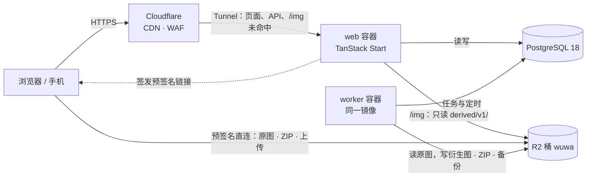
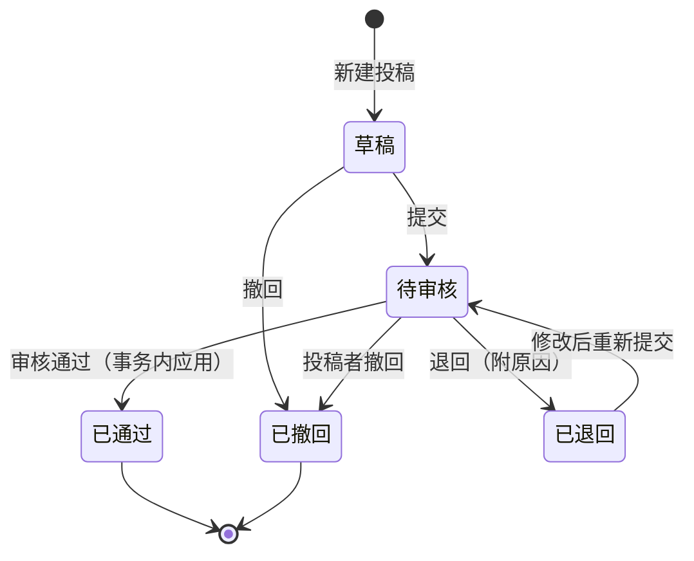

# 潮池 · 鸣潮表情包站架构与技术选型

> 版本：v2（2026-10-20，取代 v1）  
> 配套交付：[UI 设计稿](https://claude.ai/artifact/HPYzpgN3CHCHeBTjDCietY)、[架构页面](https://claude.ai/artifact/ED6C8QwKmBxKBcFnLr3a36)（与本文同内容）、[源站体检报告](https://claude.ai/artifact/1JqFG2WePMywApWRuPr4bP)、`DEVELOPMENT.md`（R2 v1 数据说明）  
> 本文不含任何密钥。

## 一页看懂

1. **应用**：一个 TanStack Start 应用提供公开站、后台和 API；同一镜像以 worker 入口跑图片处理、打包和备份；PostgreSQL 18 是唯一的数据源。Docker Compose 单机部署，经 Cloudflare Tunnel 对外，不映射任何端口。
2. **存储**：所有文件放在 R2 桶 `wuwa`，不分公开桶和私有桶。网页图片走站点的 `/img` 路由，由 Cloudflare 长期缓存；原图和 ZIP 用 2 分钟有效的预签名链接直连 R2。
3. **图片**：网页上只显示 WebP（海报 `p240`、预览 `a160`、弹窗 `full`）。原图只在「查看原图」「保存原图」和打包时下载，GIF 原样给出，不转码。
4. **角色**：站长（全部权限）、管理员（表情包、上传、分类、投稿审核、评论）、用户（投稿）。每个接口在服务端检查权限，菜单只是镜像。
5. **投稿**：所有注册用户都能投稿。草稿 → 待审核 → 已发布或已退回；已发布的包再修改，审核通过前线上保持旧版本。待审核的图片只在需要登录的预览路由里显示，不进 CDN。
6. **下载与风控**：默认对所有人开放，不需要登录。限额、速率、人机验证全部在后台配置，留空即不限制；另有两个紧急开关。人机验证用自托管的 Cap，不依赖外部网络。
7. **站名**：「潮池」，实现为变量：`SITE_NAME` 环境变量给默认值，后台「系统设置」可改。
8. **不引入额外服务**：队列（pg-boss）、限流计数、会话和搜索（pg_trgm）都在 PostgreSQL 里，不用 Redis 和搜索引擎。

---

## 1. 范围与约束

| 类别 | 要求 |
|---|---|
| 技术栈 | TanStack Start、Cloudflare、R2、WebP、PostgreSQL |
| 功能 | 登录注册、投稿与审核、后台增删改查、单张下载、整包与跨包打包、评论（可插入表情贴纸）、移动端 |
| 体验 | 轻量、首屏快；瀑布流；不要音乐播放器等累赘；重新设计字体；不用带边框、内部滚动的菜单 |
| 部署 | Docker |
| 存储 | 只用 R2 桶 `wuwa`；按类别分目录，禁止全部堆在一个目录 |

硬约束：

- 不使用 Cloudflare Workers 运行应用，不执行 wrangler。Cloudflare 只承担 DNS、CDN、WAF、Tunnel 与 R2。人机验证用自托管的 Cap，不依赖 Cloudflare 的挑战服务。
- 桶内已有 v1 布局（`meta/v1/`、`assets/v1/packs/`、`sync/v1/`），15,272 张原图不改键、不搬动。
- 密钥只通过环境变量或 Docker secrets 注入，不进仓库、镜像、文档和数据库。
- 内容授权是项目级风险，优先级高于工程决策（第 6.4 节）。

数据规模（R2 `meta/v1`，2026-10-20）：

| 项 | 数值 |
|---|---|
| 表情包 | 309 个有素材（目录 310，`linglanhuajiang-charging-20261009` 只有元数据） |
| 表情 | 15,272 张；GIF 12,276、PNG 2,996 |
| 原图体积 | 14.0 GiB；GIF 中位数 939 KB，P90 2.2 MB，最大 11.2 MB |
| 尺寸 | 抽样 420 张中 97.6% 近似正方形，常见 300×300，最大边 500 |
| 角色 / 画师 | 70 个角色（41 个哈希 slug）；结构化画师 12、分面画师名 27 |
| 下载 | 累计 1,860,771 次；第 1 名占 16.4%，前 10 名占 43.7% |

---

## 2. 请求路径



- 页面、API 和 `/img` 都经 Tunnel 到达 web 容器。`/img` 命中 Cloudflare 缓存时不回源。
- 原图、ZIP 和上传不经过应用：应用只签发链接，浏览器直连 R2 的 S3 端点。

### 2.1 路由与缓存

缓存是否可共享由应用决定。Cloudflare 不认 `Vary: Cookie`，所以 HTML 的规则是：请求带会话 Cookie（`__Secure-better-auth.session_token`）时一律 `private, no-store`；不带 Cookie 才返回 `public, s-maxage=60, stale-while-revalidate=600`，且匿名 HTML 里不能出现与身份相关的内容。

| 路由 | 用途 | 缓存 |
|---|---|---|
| `/`、`/packs`、`/packs/:slug`、`/e/:emojiId`、`/characters/:slug`、`/artists/:slug`、`/gallery`、`/explore`、`/search`、`/batch`、`/about`、`/legal` | 公开页，SSR 流式输出 | 按上面的 Cookie 规则 |
| `/submit`、`/me/*` | 投稿与个人中心，需要登录 | `private, no-store` |
| `/img/v1/:variant/:packKey/:file` | 已发布表情的 WebP 衍生图 | `public, max-age=31536000, immutable`，不看 Cookie（见 2.2） |
| `/review-img/v1/:variant/:packKey/:file` | 待审核表情的预览图，只对投稿者与审核人开放 | `private, no-store` |
| `/dl/e/:emojiId?mode=view\|save` | 查看或保存原图 | 检查后 302 到预签名链接；`private, no-store` |
| `/dl/p/:slug.zip` | 整包 ZIP | 同上；ZIP 未生成时排队，前端轮询 |
| `POST /api/batch/sign` | 打包清单分批签名 | `no-store` |
| `/api/*`、`/api/auth/*`、`/admin/*` | 前台接口、Better Auth、后台 | `no-store` |

- `/e/:emojiId` 是单张表情的分享链接：服务端渲染所属包的页面并打开单张弹窗；关闭弹窗时用 `history.pushState` 回到 `/packs/:slug`，浏览器后退可关闭弹窗。
- 源站旧地址做 301：`/archives/:slug` → `/packs/:slug`；`/tags/character-*` → `/characters/:slug`；哈希 slug 映射存在 `redirects` 表。

### 2.2 `/img` 规则

`/img` 是网页图片唯一的出口，只能读 `derived/v1/` 下已发布表情的对象：

| 项 | 规则 |
|---|---|
| 路径 | `/img/v1/<variant>/<packKey>/<emojiId>.r<rev>.webp`，版本号必带 |
| 校验 | `variant` ∈ `p240`、`a160`、`full`；`packKey` 匹配 `^[a-z0-9](?:[a-z0-9-]{0,98}[a-z0-9])?$`；`emojiId` 匹配 `^r-[0-9a-f]{20}$`；`rev` 匹配 `^[1-9][0-9]*$`。现有 309 个包键与 15,272 个表情 ID 已全部验证通过；新包的包键由服务端生成，同样满足该正则 |
| 映射 | 只拼成 `derived/v1/<variant>/<packKey>/<emojiId>.r<rev>.webp`，不接受其他前缀 |
| 命中 | 流式转发 R2 对象，`Cache-Control: public, max-age=31536000, immutable`，另加 `X-Content-Type-Options: nosniff` |
| `full` 未生成 | 只有这一步查库：表情和包都已发布、URL 的 `packKey` 等于 `storage_pack_key`、`rev` 等于 `variant_rev`，否则 404（`max-age=60`）。条件满足才入队（pg-boss 单例键为表情 ID，重复请求只排一次），并 302 到同一张图的 `a160` 地址，`Cache-Control: no-store`。worker 只按库里的字段拼对象键，不信任 URL，拒绝处理未发布的表情。这样待审核的图不会被人按 ID 请求进 `derived/` |
| 其他缺失 | 404，`Cache-Control: public, max-age=60`，避免长期缓存 404 |
| Cookie | 注册为独立路由，不调用会话接口，不经过认证中间件，响应不带 `Set-Cookie`。Cloudflare 不缓存带 `Set-Cookie` 的响应 |

版本号必带，是因为重新生成（例如改海报帧）会递增 `variant_rev`：页面总是输出新地址，旧地址留在浏览器缓存里也不会再被引用。

Cloudflare 侧：Cache Rule 对 `/img/*` 设为「遵从源站头，源站没给缓存头就不缓存」，这样 302 和 404 不会被拉长缓存；开启 Smart Tiered Cache，冷图回源集中到上层机房。冷图仍会经过主机，但对象很小（海报约 16 KB）且只做流式转发。如果将来主机带宽成为瓶颈，可以给桶绑定自定义域，用 WAF 只放行 `/derived/v1/*`，对象键不用改。

---

## 3. 存储：R2 桶 `wuwa`

```text
wuwa/
├── README.md                                          # 布局说明
├── meta/v1/ …  sync/v1/state.json                     # v1 快照：只读，仅作导入来源
├── assets/v1/packs/<packKey>/
│   ├── pack.json                                      # v1 快照文件，只读
│   └── emojis/<emojiId>.<gif|png|webp>                # 原图：现有 15,272 张 + 新上传
├── derived/v1/<p240|a160|full>/<packKey>/<emojiId>.r<rev>.webp  # 已发布表情的 WebP，经 /img 提供
├── review/v1/<p240|a160>/<packKey>/<emojiId>.webp     # 待审核表情的预览图，通过后复制到 derived/v1/
├── zips/v1/packs/<packKey>/<packKey>.<hash8>.zip      # 整包 ZIP，按内容哈希命名
├── uploads/tmp/<yyyy>/<mm>/<dd>/<uploadId>/<文件名>    # 直传暂存 · 生命周期 7 天
├── backups/postgres/<yyyy>/<mm>/<dd>/<时间戳>.dump     # 数据库备份 · 生命周期 30 天
├── docs/v1/                                           # 文档归档
└── design/v1/                                         # 设计稿归档
```

规则：

1. **分类由数据库负责**。角色、画师、标签与表情是多对多，无法用单一目录表达；目录按「对象种类 → 规格版本 → 所属包」分层，同一层不会堆上万个对象。
2. **对象写入后不搬动**。原图键记在 `emojis.original_key`；`storage_pack_key` 是入库时所属的包，之后表情改归属也不移动文件。
3. **每张表情独占自己的对象，不共用**。SHA-256 只用来发现重复：同一包内的重复文件直接跳过；与其他包重复时提示审核人。这样下架一张表情时可以直接删除它的文件，不需要引用计数。
4. **衍生图键可直接算出**：`derived/v1/<variant>/<storagePackKey>/<emojiId>.r<variant_rev>.webp`，生成 URL 不查额外的表。`variant_rev` 从 1 开始，重新生成时递增。
5. **待审核的图不进 `derived/`**。worker 把待审核表情的预览图写到 `review/v1/`，只经需要登录的 `/review-img` 提供；审核通过时复制到 `derived/v1/` 并删除预览图。退回的图片从未进入 CDN，删除时也无需清除缓存。
6. **规格升级**时生成 `derived/v2/…` 并回填，切换后整体删除 v1。
7. **会过期的对象**放在独立前缀，由 R2 生命周期规则或定时任务清理。
8. **访问方式**：已发布的衍生图只经 `/img`；原图与 ZIP 用预签名 GET（2 分钟，「保存」带 `response-content-disposition: attachment`，「查看」为 inline）；上传用预签名 PUT，只能写 `uploads/tmp/`。R2 令牌只授权桶 `wuwa`。

---

## 4. 图片策略

网页上只出现 WebP；原图只在用户明确要求时加载。

| 档位 | 规格 | 用在哪里 | 实测（300×300、28 帧、690 KB 的 GIF） |
|---|---|---|---|
| 原图 | GIF / PNG，原样 | 「查看原图」「保存原图」、ZIP | 690 KB |
| `p240` 海报 | 静态 WebP q72，最长边 240 | 所有网格、卡片、评论贴纸的默认显示 | 16 KB；25 张一包合计 360 KB |
| `a160` 预览 | 动画 WebP q40，最长边 160，抽帧到 ≤ 24 帧 | 悬停或进入可视区时播放 | 109 KB（抽到 14 帧） |
| `full` | 动画 WebP q60，原尺寸全帧 | 单张弹窗；首次查看时生成，生成前显示 `a160` | 425 KB |

- 199 帧、7.0 MB 的 GIF：`a160` 为 188 KB（23 帧），`full` 约 2.9 MB。
- 海报帧取第 0、¼、½、¾ 帧中图像熵最高的一帧。样本 130 张动图中有 76 张因此换帧；所选帧写入 `emojis.poster_frame`，后台可改。
- 抽帧实现：先把保留的帧拼成长条并缩放，再用 sharp 的 `raw: { width, height, channels, pageHeight }` 重新包装后编码。`webp()` 没有 `pageHeight` 参数，传了会被忽略，输出变成一张竖长的静态图；生成后检查帧数。
- sharp 只在 worker 里运行：libvips 会把所有帧解码成一张长图（500×500×199 帧约 200 MB），因此图片并发设为 1（内存上限 2 GB 时可设为 2），`sharp.cache(false)`，每个任务设超时，`limitInputPixels` 按「帧数 × 宽 × 高」设置。

---

## 5. 角色与投稿

### 5.1 三种角色

| 能做什么 | 站长 | 管理员 | 用户 |
|---|:-:|:-:|:-:|
| 浏览、下载、收藏、评论 | ✓ | ✓ | ✓ |
| 投稿表情包（需审核，可设免审） | ✓ | ✓ | ✓ |
| 审核投稿，发布与下架表情包 | ✓ | ✓ | — |
| 表情包与表情增删改查、上传中心 | ✓ | ✓ | — |
| 角色、画师、标签整理与合并 | ✓ | ✓ | — |
| 评论审核、屏蔽词、禁止评论 | ✓ | ✓ | — |
| 用户与角色、下载与风控 | ✓ | — | — |
| 存储、任务、审计、系统设置 | ✓ | — | — |

- 只有站长能任命或撤销管理员。最后一位站长不能被降级、封禁或删除。
- 每个用户有投稿模式：`review`（默认，需审核）、`trusted`（免审，直接发布）、`blocked`（禁止投稿）。投稿模式只有站长能改，管理员不能给自己免审。
- 用户只能修改自己的投稿：查询都带 `owner_id`；签发上传链接前校验投稿属于当前用户，或当前用户有审核权限。对象键由服务端生成。
- 每次写操作写入 `audit_logs`，记录操作人、当时的角色；站长以「模拟登录」代操作时另记 `impersonated_by`。

实现：

- Better Auth `admin()` 插件配合自定义访问控制，角色为 `admin`（站长）、`manager`（管理员）、`user`。`admin` 角色要显式包含插件自带的 `adminAc.statements`，否则站长自己调用设置角色等接口也会被拒绝。`adminRoles` 只有 `admin`，管理员拿不到设置角色、封禁、模拟登录等接口。
- 「至少一位站长」由 `user` 表上的数据库触发器保证（`BEFORE UPDATE OF role, banned OR DELETE`），因为插件的设置角色、封禁、删除接口不经过业务代码。触发器先锁定全部站长行（`FOR UPDATE`）再计数，两个并发操作不会同时成功。
- 业务权限写成共用的服务端函数中间件 `requirePerm(perm)`：每个服务端函数和 API 路由都要声明所需权限，CI 检查是否有遗漏，不靠每个处理函数自觉检查。
- 验收测试：管理员调用设置角色接口返回 403；把最后一位站长降级失败。

### 5.2 投稿状态



- 投稿有三类：新包、补充表情、修改已发布的包。都存在 `submissions` 表，`payload` 保存提议的内容（标题、简介、角色、画师、增删的表情、授权声明）。
- 新包投稿会先建一个 `status = draft` 的包，属于投稿者，前台不可见。
- 上传：浏览器申请预签名 PUT，直传 `uploads/tmp/…`；worker 校验 MIME 与像素上限、计算 SHA-256（同一包内重复直接跳过）、选海报帧、把原图写到 `assets/v1/packs/<packKey>/emojis/`、把 `p240` 与 `a160` 预览图写到 `review/v1/`。表情状态为 `pending`，投稿者和审核人经 `/review-img` 预览。
- 审核通过时：在一个事务里应用 `payload`（表情转为 `published`、更新包信息、写审计日志），由审核人确认「允许下载」开关；同一个任务把预览图复制到 `derived/v1/` 并删除 `review/v1/` 下的副本。
- 修改已发布的包时，`payload` 记录基准版本 `base_updated_at`。审核通过前线上一直显示旧版本；如果期间包已被别人改过，审核通过会失败，需要重新提交。
- 免审用户提交后直接走「审核通过」这一步，同样写审计日志。
- 定时清理：退回或撤回超过 30 天的投稿、90 天未修改的草稿，删除其原图与预览图。

---

## 6. 下载、打包与风控

### 6.1 下载方式

| 场景 | 流程 |
|---|---|
| 查看原图 | `/dl/e/:id?mode=view` → 检查 → 302 到 inline 预签名链接 |
| 保存原图 | `/dl/e/:id?mode=save` → 检查 → 302 到 attachment 预签名链接 |
| 整包 ZIP | `/dl/p/:slug.zip` → 检查 → 命中 `zip_artifacts` 则 302，否则排队生成 |
| 打包清单 | 浏览器用 client-zip 流式打包；边打包边调用 `POST /api/batch/sign`，每批最多 20 张；每 200 张一个压缩包 |

检查顺序：

1. 可下载：表情和包都已发布，且包的「允许下载」开启。待审核或已退回投稿里的原图只对投稿者和审核人签发。
2. 紧急开关：「原图仅限登录用户」「暂停整包与打包」。
3. 速率与限额：见 6.2。
4. 签发时计数。预签名链接被浏览器直接使用、不经过应用，所以计数只能在签发时完成。打包清单每批最多 20 张、链接有效 2 分钟，边打包边签下一批，慢网速下也不会中途过期；放弃的打包只计已签发的批次。

打包清单存在浏览器里，登录后同步到账号。每个压缩包附带 `CREDITS.txt`：包名、画师、约稿人、许可与来源。微信、QQ 内置浏览器无法下载压缩包，检测到时提示「在浏览器打开」。

### 6.2 风控设置

都在后台「下载与风控」里配置。限额项留空即不限制。

| 设置 | 默认 | 说明 |
|---|---|---|
| 每个 IP 每天原图张数 | 留空 | 「查看原图」「保存原图」和打包都计入；WebP 预览不计 |
| 每个账号每天原图张数 | 留空 | 登录用户按账号计 |
| 每个 IP 每天整包次数 | 留空 | 整包 ZIP 与打包清单都计入 |
| 单次打包张数上限 | 留空 | 超过 200 张自动分成多个压缩包 |
| 单张签发速率 | 开，每个 IP 每分钟 60 次 | 只计单张「查看」「保存」，超出返回 429 |
| 打包签发速率 | 留空 | 每个 IP 每分钟可签发的打包张数；与单张分开计，正常打包不会触发单张限速 |
| 可疑时人机验证 | 开 | 连续顺序抓取或没有 Referer 时要求通过 Cap 验证 |
| 原图仅限登录用户 | 关 | 紧急开关：游客只能看 WebP 预览 |
| 暂停整包与打包 | 关 | 紧急开关：只保留单张下载 |
| R2 读操作月度告警 | 900 万 | 超过时邮件通知站长 |

实现：

- 主体是 IP 加盐哈希或账号。IP 一律取 `CF-Connecting-IP`，不读 `X-Forwarded-For`。
- 计数表 `download_counters` 为 UNLOGGED 表，按主体、日期和类别计数。类别：`orig`（单张）、`batch_item`（打包的每一张，计入每天原图张数）、`batch`（每个压缩包，计入每天整包次数）、`zip`（整包 ZIP）。两个签发速率用按分钟的计数窗口。
- UNLOGGED 表在崩溃恢复后会清空，对日限额可以接受；每小时把计数汇总到普通表 `download_stats_daily`，月度告警和统计以它为准。
- 读操作告警按「原图与 ZIP 签发次数 + `/img` 回源次数」估算。
- 可疑来源列表支持封禁或观察，并在后台显示特征（连续顺序抓取、无 Referer 等）。
- Cloudflare WAF 在 `/dl/*` 与 `/api/batch/*` 上再加一层速率限制。
- 达到限额时提示「明天恢复」，并引导登录。

### 6.3 下架

删除表情或处理版权申诉时：删除原图与全部衍生图（所有档位、所有 `.r<rev>` 版本），重建或删除受影响的 ZIP，再调用 Cloudflare API 按 URL 清除这些 `/img` 地址的缓存。`/img` 响应是一年期的不可变缓存，只删 R2 对象不会让图片从 CDN 消失；已经下载到访客浏览器里的副本无法收回。worker 使用一枚只有「缓存清除」权限的 Cloudflare 令牌。

### 6.4 授权

`DEVELOPMENT.md` 第 2.2 节写明当前镜像只供个人或本地开发，未经站方许可不得公开再分发。工程上这样处理：

| 内容 | 处理 |
|---|---|
| CC BY-NC-SA 4.0 社区包 | 核对许可后开启「允许下载」；页面与 ZIP 展示署名 |
| 「个人非商用约定」类包 | 默认只提供预览，取得画师授权后开启 |
| 官方表情（官转） | 「允许下载」固定关闭，只提供预览 |
| 投稿 | 投稿者声明身份（画师本人、约稿人、已获授权、整理搬运）、许可与凭证；审核人确认「允许下载」 |

v1 数据导入时所有包的「允许下载」都关闭，逐个核对后开启。M0 需要联系源站站长，确认可公开的范围。

---

## 7. 数据模型

PostgreSQL 是元数据唯一权威；R2 的 `meta/v1/*.json` 只用于首次导入。

```text
packs            id, pack_key (不可变), slug (可改，旧值进 redirects), title, excerpt, description_md,
                 status (draft|published|hidden), owner_id, source_kind (community|official),
                 license (封闭枚举), downloadable, pin_level, memorial, commissioner, credits_text,
                 source_url, cover_emoji_id, emoji_count, download_count, favorite_count,
                 published_at, created_at, updated_at
emojis           id (r- + 20 位十六进制，沿用 v1), pack_id, storage_pack_key (不可变),
                 status (pending|published|hidden), sort_order, original_key, format, bytes,
                 width, height, frames, duration_ms, poster_frame, sha256, dominant_color,
                 variant_rev (从 1 开始), p240_bytes, a160_bytes, full_ready, created_at
submissions      id, kind (new_pack|add_emojis|edit_pack), pack_id, submitter_id,
                 status (draft|pending|approved|returned|withdrawn), payload jsonb,
                 declaration jsonb, reviewer_id, review_note, submitted_at, decided_at
upload_items     id, submission_id, uploader_id, tmp_key, status, error, emoji_id
users …          Better Auth 生成；role (admin|manager|user)，submit_mode (review|trusted|blocked)
characters, character_aliases, artists, artist_aliases          -- 别名与合并后的旧名用于搜索
pack_characters, emoji_characters, pack_artists                 -- 多对多
tags (dimension: group|tool|project|origin|custom), pack_tags
collections, collection_packs                                   -- 精选合集
favorite_folders, favorites (target_type pack|emoji)
batch_lists      user_id, items jsonb, updated_at               -- 打包清单（登录后同步）
download_counters (UNLOGGED)  subject, day, kind (orig|batch_item|batch|zip), n
download_stats_daily          day, kind, subject_count, n       -- 每小时从计数表汇总，供统计与告警
blocked_sources  subject, mode (block|watch), reason, until
zip_artifacts    pack_id, content_hash, object_key, bytes, built_at
comments         id, thread_type, thread_id, parent_id, root_id, author_id | guest_name,
                 guest_email_hash, body_src, sticker_ids text[], status, pinned, staff_badge,
                 edited_at, deleted_at, ip_hash, created_at
comment_reactions, comment_reports
redirects, site_settings (key, value jsonb)
audit_logs       actor_id, actor_role, impersonated_by, action, target, diff jsonb, created_at
```

- 每张图都存宽高、帧数、海报帧与 SHA-256：宽高让瀑布流零偏移，SHA-256 在入库前拦下重复文件。
- 站名、风控设置、紧急开关都存在 `site_settings`，改动即时生效并写审计日志。
- 评论只存 `body_src`，读取时渲染并做进程内缓存。

---

## 8. 前端

- **瀑布流**：`useWindowVirtualizer({ lanes, estimateSize })`，宽高来自数据库，布局零偏移。
- **动图播放**：网格默认显示 `p240`；悬停或进入可视区中心时换成 `a160`；同时播放不超过 4 张；用户可关闭，检测到 `Save-Data` 时自动关闭。
- **单张表情**：弹窗，按贴纸原尺寸（约 300 px）显示，不铺满屏幕；手机上是底部面板，高度不超过屏幕的 72%。
- **筛选**：目录页用顶部筛选条和按内容定高的下拉面板，不用带边框、内部滚动的侧栏。页面内的滚动区域隐藏滚动条，只有页面本身保留细滚动条。
- **字体**：正文用系统字体；数字与拉丁字母用自托管的 Nunito 拉丁子集；标题用寒蝉圆黑体（OFL-1.1）Bold 与 Heavy，以别名 `TP Rounded` 发布，用 cn-font-split 切成按 `unicode-range` 加载的分片。上游字体的 `locl` 对所有语言生效，会把「户」「令」和数字换成日文字形，切分前先去掉 `locl`，生成后检查这几个字。
- **动效**：只用 CSS 与 Web Animations API；页面切换用原生 View Transitions；`prefers-reduced-motion` 时关闭。
- **复制图片**：剪贴板只能写入 PNG，动图提示改用「保存原图」。
- **性能预算**：首屏 JS ≤ 110 KB（gzip）、CSS ≤ 30 KB、字体 ≤ 150 KB/页、LCP ≤ 2.5 s（4G 手机）、CLS ≤ 0.02、INP ≤ 150 ms、单页请求 ≤ 40 个。

---

## 9. 评论与搜索

评论：

- 楼中楼、Markdown 子集、表情回应、10 分钟编辑窗、删除保留墓碑、置顶、站长与画师徽章、三种排序。
- 贴纸：正文写作 `:s[r-0a7bf47f0ec26d3843bf]`，ID 先过正则 `^r-[0-9a-f]{20}$`，再校验表情存在且已发布，每条最多 6 张；显示为 `p240`。
- markdown-it：`html: false`，禁用图片，保留默认的 `validateLink`，链接加 `rel="nofollow ugc noopener"`；全站配置 CSP。
- 反垃圾：游客必须通过 Cap 验证；按 IP 哈希与账号限流；隐藏字段陷阱与最短填写时长；新用户首评、2 个以上链接、命中屏蔽词、被举报达到阈值的进入审核队列，不静默丢弃。

搜索：

- 包标题、角色名与别名、画师名与别名、标签名建 `pg_trgm` GIN 索引。PostgreSQL 18.4 实测：中文能正常生成三元组，3 字以上的 `ILIKE '%…%'` 走索引。
- 单字角色名（心、椿）先查别名表精确匹配；指令面板读进程内索引。
- 使用 Debian 系镜像；Alpine（musl）未验证。

---

## 10. 认证与安全

- Better Auth：邮箱密码（要求邮箱验证）、通行密钥、可选 GitHub OAuth；`tanstackStartCookies()` 放在插件列表最后。
- 人机验证用自托管的 Cap（SHA-256 工作量证明，用户无需点选图片）。Turnstile 依赖 Cloudflare 的挑战服务，部分网络下加载不稳定，所以不用。`@cap.js/server` 嵌在应用里，挑战与令牌存在 PostgreSQL，不需要额外容器。
- Better Auth 的 `captcha()` 插件不支持 Cap：在注册、登录、重置密码接口上加 before 钩子，调用 `validateToken(token, { keepToken: false })`，令牌用一次即失效。签发挑战的公开接口按 IP 限速，因为每次签发都写一行数据。
- Cap 前端组件默认从 jsDelivr 加载 WASM 与 pako，改为从本站提供；CSP 需要 `worker-src blob:` 与 `'wasm-unsafe-eval'`。
- 客户端 IP 用 `cf-connecting-ip`（`advanced.ipAddressHeaders`）。只有源站完全不暴露端口时这个头才可信：只经 Tunnel 访问，调试时也不临时映射端口。
- 自定义 `src/start.ts` 会关闭 Start 自动挂载的 CSRF 中间件，必须手动加 `createCsrfMiddleware()`。
- IP 与 UA 只存加盐哈希；公开接口不返回邮箱。
- 密钥放在 `.env` 或 Docker secrets：R2 令牌只授权桶 `wuwa`；缓存清除令牌只有该权限。后台只显示「已配置」。
- 本项目对话中出现过明文 R2 密钥与 Cloudflare 令牌，项目搭建完成后轮换。

---

## 11. 技术栈

版本取自 `https://registry.npmjs.org/<包名>`，核实日期 2026-10-20，上线前按 lockfile 固定。

| 层 | 选型 | 版本 | 说明 |
|---|---|---|---|
| 运行时 | Node.js | 24 LTS | Debian slim 镜像，保证 sharp 预编译二进制可用 |
| 框架 | `@tanstack/react-start` | 1.169.3 | 1.169 为首个稳定版；需要 Vite 8 |
| 构建 | `vite` / `@vitejs/plugin-react` | 8.3.4 / 6.1.2 | |
| Node 输出 | `nitro`（`node_server` 预设） | 3.0.260903-beta | 唯一未经充分验证的环节；固定版本，回退见 12.3 |
| UI | `react` / `react-dom` | 19.3.1 | |
| 无样式组件 | `@base-ui/react` | 1.9.0 | 外观按设计令牌自建；animal-island-ui 只沿用令牌与规格，运行时零依赖 |
| 数据获取 | `@tanstack/react-query` | 5.104.5 | 首屏由路由 loader 直出 |
| 虚拟列表 | `@tanstack/react-virtual` | 3.14.21 | `lanes` 实现瀑布流 |
| 认证 | `better-auth` + `@better-auth/drizzle-adapter` + `@better-auth/passkey` | 1.7.11 | 适配器 peer 范围与 Drizzle 0.45.4 兼容 |
| ORM | `drizzle-orm` / `drizzle-kit` / `pg` | 0.45.4 / 0.31.11 / 8.23.1 | |
| 数据库 | PostgreSQL | 18（Debian 镜像） | `pg_trgm` 中文检索已实测 |
| 任务队列 | `pg-boss` | 12.38.0 | 定时任务支持时区；单例队列 |
| 图片 | `sharp` | 0.35.5 | 只在 worker 中运行；约束见第 4 节 |
| 对象存储 | `@aws-sdk/client-s3` + `@aws-sdk/s3-request-presigner` | 3.1153.0 | R2 S3 端点，region 为 `auto` |
| 打包 | `client-zip` / `archiver` | 2.5.1 / 8.0.0 | 浏览器端流式打包；服务端整包 ZIP 用存储模式 |
| 人机验证 | `@cap.js/server` / `@cap.js/widget` | 4.0.5 / 0.1.58 | 自托管工作量证明，WASM 从本站提供 |
| 其他 | `zod` 4.6.7 · `markdown-it` 15.0.3 · `pino` 10.4.0 · `cn-font-split` 7.4.3 | | |

animal-island-ui 2.3.0 不进入运行时：它的样式会带入 3 个各约 1.1 MB 的 Noto Sans SC 字体（无 `unicode-range`），有 830 处写死的颜色，`Drawer` 服务端渲染报错，`Notification` 在 React 19 下报错。令牌已导出为 `design/tokens.css`。

---

## 12. 部署

### 12.1 应用结构

```text
src/
  routes/       公开页、/admin、/api、/dl、/img、/review-img
  server/       db（Drizzle）、auth、perm（角色与权限）、media（R2、键名、sharp）、
                downloads（检查、计数、签发）、submissions、comments、search
  ui/           组件与样式（tokens.css 来自 design/tokens.css）
  shared/       zod schema、权限常量、错误码
  worker.ts     pg-boss 消费者与定时任务
  migrate.ts    迁移入口
drizzle/        迁移文件（需单独复制进镜像）
docker/         Dockerfile、compose.yaml
```

单包、两个入口；`worker.ts` 与 `migrate.ts` 用 esbuild 单独打包，`sharp` 保持为外部依赖。

### 12.2 Docker Compose

```yaml
services:
  db:
    image: postgres:18-bookworm
    volumes: [pgdata:/var/lib/postgresql]          # 18 起 PGDATA 为 /var/lib/postgresql/18/docker，挂载上一级
    environment: [POSTGRES_DB=chaochi, POSTGRES_USER=chaochi, POSTGRES_PASSWORD_FILE=/run/secrets/pg_password]
    secrets: [pg_password]
    healthcheck: { test: ["CMD", "pg_isready", "-U", "chaochi"], interval: 5s, retries: 20 }
  migrate:
    image: chaochi/app:${TAG}
    command: ["node", "dist/migrate.mjs"]
    env_file: .env
    depends_on: { db: { condition: service_healthy } }
    restart: "no"
  web:
    image: chaochi/app:${TAG}
    command: ["node", ".output/server/index.mjs"]
    env_file: .env                                 # SITE_NAME、SITE_DOMAIN、R2_BUCKET=wuwa 等
    depends_on: { migrate: { condition: service_completed_successfully } }
    healthcheck: { test: ["CMD", "node", "-e", "fetch('http://127.0.0.1:3000/api/health').then(r=>process.exit(r.ok?0:1))"] }
  worker:
    image: chaochi/app:${TAG}
    command: ["node", "dist/worker.mjs"]
    env_file: .env
    mem_limit: 2g
    cpus: 1                                        # 回填与长动图转码时不拖慢网站
    depends_on: { migrate: { condition: service_completed_successfully } }
  tunnel:
    image: cloudflare/cloudflared:2026.10.1
    command: ["tunnel", "run"]
    environment: [TUNNEL_TOKEN_FILE=/run/secrets/tunnel_token]
    secrets: [tunnel_token]
secrets:
  pg_password: { file: ./secrets/pg_password }
  tunnel_token: { file: ./secrets/tunnel_token }
volumes: { pgdata: {} }
```

- 任何服务都不映射端口到宿主机。
- 镜像基于 `node:24-bookworm-slim` 多阶段构建；Nitro 不会把 `drizzle/` 复制到 `.output`，Dockerfile 单独复制；worker 层安装 `postgresql-client-18` 用于 `pg_dump`。
- `.dockerignore` 排除 `.env*`、`secrets/`、`node_modules`、`data/`。

### 12.3 Nitro v3 beta 的回退

`@tanstack/nitro-v2-vite-plugin` 已在 Start 1.169 中移除，回退方案不是退回 Nitro v2，而是不用 Nitro 构建：用 `srvx` 包装 Start 产出的 fetch handler，由同一进程托管 `dist/client`。M0 验证四项：Docker 中启动、流式 SSR、sharp 作为外部依赖可加载、迁移目录已复制。任一项因 Nitro 失败就切换。

### 12.4 Cloudflare 与 R2 配置

| 项 | 配置 |
|---|---|
| DNS | 站点域名代理到 Tunnel；不需要图片子域 |
| Cache Rules | `/img/*` 遵从源站头，源站没给缓存头就不缓存；`/assets/*`、`/fonts/*` 缓存一年；HTML 遵从源站头 |
| Tiered Cache | 开启 Smart Tiered Cache |
| WAF | `/dl/*`、`/api/batch/*`、`/api/*` 速率限制 |
| 人机验证 | Cap 自托管：注册、登录、重置密码、游客评论、可疑下载；不需要 Cloudflare 侧配置 |
| R2 CORS | 桶 `wuwa`：允许站点源的 GET（浏览器端打包）与 PUT（上传） |
| 生命周期 | `uploads/tmp/` 7 天；`backups/` 30 天 |
| 缓存清除 | 只在下架时按 URL 清除；衍生图与 ZIP 都按版本或内容哈希命名 |

定时任务（pg-boss，Asia/Shanghai）：每小时把下载计数汇总到 `download_stats_daily`；每天 03:00 备份数据库到 `backups/postgres/`；每天 04:00 检查读操作告警；每天清理过期的投稿文件与草稿（第 5.2 节）。ZIP 只在包发布或内容变化时重建。

---

## 13. 里程碑

| 阶段 | 内容 | 完成标志 |
|---|---|---|
| M0 基础 | 仓库、CI、Docker、schema、角色与权限、v1 导入、尺寸回填；联系源站确认授权范围 | Nitro 四项验证通过；309 个包与 15,272 张可在测试环境浏览；管理员调用设置角色接口返回 403 |
| M1 浏览 | 公开页、`/img`、`p240` 与 `a160` 回填、缓存规则 | 设计稿公开页可用，性能预算达标 |
| M2 下载与风控 | 查看与保存原图、整包 ZIP、打包清单、风控设置、紧急开关、CREDITS | 只有允许下载的已发布包能签发原图；留空的限额不生效，填写后生效 |
| M3 投稿与后台 | 投稿、审核、上传流水线、预览图复制与清理、包与表情管理、分类合并、下架与缓存清除、审计 | 日常维护不再需要脚本；投稿状态与第 5.2 节一致；退回的图片在 `/img` 上不可访问 |
| M4 评论 | 贴纸、回应、审核、站内通知 | 审核规则与设计稿一致 |
| M5 打磨 | 字体分片、旧链接 301、无障碍、SEO、监控 | 移动端 Lighthouse 性能分数〔目标值待确认〕 |

---

## 14. 决策

| 编号 | 决策 | 一句话理由 |
|---|---|---|
| D1 | 自研 TanStack Start，不用 EmDash | 难点是动图流水线、瀑布流、打包与贴纸评论，通用 CMS 帮不上；见附录 A |
| D2 | 单桶 `wuwa`；网页图片经 `/img` 由 CDN 缓存；原图与 ZIP 用预签名链接 | 用户要求只用一个桶；对象小、键不可变，CDN 能承担 |
| D3 | Base UI + 自建组件；animal-island-ui 只用令牌 | 它的样式和组件有体积与兼容问题 |
| D4 | Drizzle 0.45.4 | 与 Better Auth 适配器 peer 范围兼容 |
| D5 | 打包在浏览器端完成，不需要登录，每 200 张一个压缩包，分批签名 | 不占服务器带宽；分批签名让 2 分钟有效期不会中途过期 |
| D6 | 搜索用 pg_trgm | 中文已实测可用，不需要额外服务 |
| D7 | 单包、两个入口（web、worker） | 一个镜像，部署简单 |
| D8 | 不引入 Redis | 队列、计数和会话都放在 PostgreSQL |
| D9 | Node 24 LTS | Start 与 pg-boss 要求 ≥ 22.12 |
| D10 | 接受 Nitro v3 beta 并固定版本 | 回退方案写进 M0 |
| D11 | 三种角色：站长、管理员、用户 | 权限下放给管理员，站长保留用户、风控与系统 |
| D12 | 投稿对所有注册用户开放，单表 `submissions` 管理审核；待审核的预览图放 `review/v1/` | 不再由站长一人上传；未通过的图片不进 CDN |
| D13 | 网页只显示 WebP；原图只在查看、保存、打包时下载 | 性能；GIF 原样保留 |
| D14 | 风控全部可配置，留空不限，另有两个紧急开关 | 默认开放，被刷时能立即收紧 |
| D15 | 站名「潮池」用变量实现 | 改名不改代码 |
| D16 | 每个包一个「允许下载」开关；导入时全部关闭，官方包固定关闭 | 授权是项目级风险 |
| D17 | 人机验证用自托管 Cap，不用 Turnstile | Turnstile 依赖 Cloudflare 网络，部分地区加载不稳定；Cap 在本站内完成 |
| D18 | worker 独立容器，限制 2 GB 内存与 1 个 CPU | 开放投稿后要处理陌生人的文件；图片任务出问题不影响网站 |

---

## 附录 A：为什么不用 EmDash

EmDash（Cloudflare 出品的 Astro 全栈 CMS）作为通用 CMS 更完整：后台、通行密钥与 OAuth、带 Turnstile 的评论审核、签名直传的媒体库、修订与定时发布都是现成的。但本项目的难点它帮不上：1.5 万张动图的 WebP 流水线、依赖宽高的瀑布流、打包与 CREDITS、评论贴纸、角色与画师的多对多、旧链接 301。用通用集合模拟这些模型、改评论核心支持贴纸、在 Node 上为插件沙箱跑 workerd，成本都比自研高，而且 Astro 不符合指定栈。

借鉴：EmDash 的签名直传与最低权限角色；Garrul 的楼中楼、回应、编辑时限与分层反垃圾；Ecoku 的「贴纸以纯文本标记保存、显示时渲染」与删除保留墓碑。三者都不直接部署。

## 附录 B：评审与变更记录

- v1 经 Fable 评审定稿（D1–D11）。当时与 Fable 不一致的两点保留至今：衍生图键保留包名这一层（用户要求按类别分目录）；cloudflared 的 `TUNNEL_TOKEN_FILE` 经源码确认可用。
- v2 按用户反馈修改：改为单桶（v1 为私有桶加公开桶 `wuwa-public`）；打包不再要求登录；角色从两级改为三级并开放投稿；新增网页只用 WebP、可配置风控与下架清除缓存；站名改为变量。
- v2 的新机制经 Fable 评审，采纳的修改：`/img` 地址必带版本号、Cache Rule 遵从源站头、`/img` 不经过认证中间件；待审核预览图放 `review/v1/`，通过后复制；单张与打包分开限速，计数每小时汇总到普通表；表情不共用对象；修改已发布的包时校验基准版本；站长角色显式包含插件权限；投稿模式只由站长修改；审计记录代操作人；权限检查走共用中间件。
- 用户要求人机验证改用 Cap（D17），worker 保持独立并限制 CPU（D18）。
- 2026-10-20 重新实测 `a160`：此前的抽帧脚本输出的是静态长图，修正后为 109 KB（14 帧）与 188 KB（23 帧）。

## 参考来源

- TanStack Start 部署：<https://tanstack.com/start/latest/docs/framework/react/guide/hosting>
- Better Auth TanStack 集成：<https://www.better-auth.com/docs/integrations/tanstack>
- Better Auth admin 插件：<https://www.better-auth.com/docs/plugins/admin>
- TanStack Virtual：<https://tanstack.com/virtual/latest/docs/api/virtualizer>
- pg-boss 定时任务：<https://pgboss.io/api/scheduling>
- Drizzle 迁移：<https://orm.drizzle.team/docs/migrations>
- sharp 构造参数：<https://sharp.pixelplumbing.com/api-constructor>
- client-zip：<https://github.com/Touffy/client-zip>
- cloudflared token 文件：<https://github.com/cloudflare/cloudflared/blob/master/cmd/cloudflared/tunnel/subcommands.go>
- PostgreSQL Docker 镜像：<https://hub.docker.com/_/postgres>
- cn-font-split：<https://www.npmjs.com/package/cn-font-split>
- 寒蝉圆黑体：<https://github.com/Warren2060/ChillRoundGothic>（OFL-1.1）
- animal-island-ui：<https://github.com/guokaigdg/animal-island-ui>（MIT）
- Garrul：<https://github.com/KingPin/Garrul>（Apache-2.0）
- Ecoku 贴纸说明：<https://ecoku.zsh.moe/integration/smoji>
- EmDash：<https://github.com/emdash-cms/emdash>（MIT）
